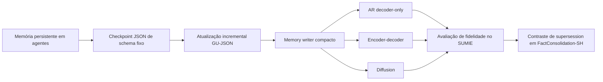

# Ficha do tema — Trabalho de Conclusão de Curso

## Identificação

| Campo | Preenchimento |
| --- | --- |
| Aluno(a) | Guilherme Henrique Siqueira Lopes |
| Curso / Semestre | Sistemas de Informação - 2025/2 |
| Orientador(a) | Alex Coelho - a confirmar |

## Tema (1 frase)

Avaliação de modelos compactos na atualização incremental de memória JSON para agentes.

**Recorte atual:** avaliação de modelos pequenos como componentes de escrita de memória, e não comparação de sistemas completos de agentes nem afirmação causal isolada sobre arquiteturas. [[01_Projeto/01_visao_geral|Visão geral]]; [[01_Projeto/03_justificativa_lacuna|Justificativa e lacuna]]

## Facetas selecionadas (4-7)

| Faceta | Delimitação atual |
| --- | --- |
| Objeto/Fenômeno | Atualização incremental e persistência de estado em um checkpoint JSON de schema fixo, usando Generate-Update em JSON (GU-JSON). [[02_Metodologia/01_metodo_memoria_GU_JSON|Método GU-JSON]]; [[02_Metodologia/02_schema_checkpoint|Schema do checkpoint]] |
| Contexto/Setor | Agentes baseados em modelos de linguagem que recebem informação em etapas e precisam adicionar, atualizar, preservar ou substituir estado. O foco experimental é o componente que escreve a memória. [[01_Projeto/01_visao_geral|Visão geral]]; [[01_Projeto/02_perguntas_hipoteses|Perguntas e hipóteses]] |
| População/Modelos | Representantes compactos de três paradigmas: Qwen3-0.6B autoregressivo decoder-only, T5Gemma B-B PrefixLM-IT encoder-decoder e Qwen3-0.6B Diffusion BD3LM. O checkpoint exato e a API do modelo diffusion precisam ser confirmados. [[02_Metodologia/04_modelos|Modelos do experimento]] |
| Tempo | Execução experimental planejada no período do TCC; a revisão cobre os trabalhos relevantes registrados no mapa de literatura. O recorte temporal final da busca deve ser explicitado no protocolo. [[03_Revisao_Literatura/00_mapa_literatura|Mapa da literatura]]; [[03_Revisao_Literatura/05_metodologia_revisao|Metodologia de revisão]] |
| Geografia | Não se aplica como população geográfica. O contexto técnico é a execução local dos modelos. [[02_Metodologia/07_hardware_tempos|Hardware e execução local]] |
| Dados/Fontes | SUMIE como dataset principal; amostra delimitada de FactConsolidation-SH para contraste de supersession; estados esperados, outputs dos writers e referências bibliográficas. [[02_Metodologia/03_datasets|Datasets]]; [[06_Referencias/referencias|Referências]] |
| Método/Abordagem | Experimento controlado com GU-json, schema fixo e limite de saída fixo em 300 tokens. Mantêm-se iguais dataset, sequência, prompt e parâmetros de geração; varia-se apenas o modelo escritor. [[02_Metodologia/01_metodo_memoria_GU_JSON|Método GU-json]]; [[02_Metodologia/06_plano_experimental|Plano experimental]] |
| Métricas/Variáveis | JSON/schema validity; State Precision, Recall e F1; Preservation e Update Accuracy; Supersession Accuracy, stale fact e hallucination rate. Análise por turno e operação de estado. [[02_Metodologia/05_metricas|Métricas de qualidade]] |
| Restrições/Viabilidade | Execução local no Lenovo IdeaPad Gaming 3i, i5 de 10ª geração, 24 GB RAM e GTX 1650; PC 2 auxilia na preparação e análise. Compatibilidade dos modelos verificada no piloto. [[02_Metodologia/07_hardware_tempos|Hardware e execução local]] |

## Matriz de verificação (0-2 por critério)

> Avaliação preliminar interna do projeto; não é nota oficial nem resultado de validação institucional.

| Critério | Nota | Justificativa |
| --- | --- | --- |
| Relevância | 2 | Persistir e atualizar estado é uma função central em agentes com tarefas multi-etapas; o estudo avalia fidelidade e preservação de informação. [[03_Revisao_Literatura/00_mapa_literatura|Mapa da literatura]] |
| Alinhamento | 2 | O tema combina Sistemas de Informação, inteligência artificial, engenharia de software experimental e avaliação quantitativa. **Avaliação de enquadramento deste projeto.** |
| Viabilidade temporal | 2 | Três writers, SUMIE e uma amostra delimitada de FactConsolidation-SH mantêm o protocolo focal; o piloto valida a integração antes da coleta. [[02_Metodologia/06_plano_experimental|Plano experimental]] |
| Acesso a dados | 1 | Os datasets são identificados e têm fontes públicas, mas download, licenças, adaptação ao protocolo e estados de referência precisam ser verificados antes da coleta. [[02_Metodologia/03_datasets|Datasets]] |
| Delimitação/Escopo | 2 | Método GU-json, schema, limite de memória e dataset principal estão fixos; FactConsolidation-SH é somente um contraste amostrado. Falta fechar os checkpoints dos writers. [[01_Projeto/01_visao_geral|Visão geral]]; [[02_Metodologia/04_modelos|Modelos]] |
| Originalidade | 1 | A lacuna é plausível como comparação controlada de representantes compactos usados exclusivamente como writers, mas depende de revisão focal e não deve ser apresentada como ausência definitiva de estudos. [[01_Projeto/03_justificativa_lacuna|Justificativa e lacuna]] |
| **Total** | **10/12** | Proposta focal e viável em princípio; acesso operacional aos dados e originalidade ainda exigem validação. |

## Problema de pesquisa

Agentes que recebem informações em etapas precisam manter uma representação persistente do estado. Checkpoints JSON permitem explicitar campos e comparar o estado produzido com referências estruturadas, mas cada atualização pode omitir fatos válidos, manter informação obsoleta, alterar valores, inventar conteúdo ou produzir JSON inválido. [[01_Projeto/01_visao_geral|Visão geral]]; [[02_Metodologia/02_schema_checkpoint|Schema do checkpoint]]

A literatura relacionada aborda memória estruturada, atualização incremental, avaliação de memória e geração estruturada. Esses eixos dão base ao uso de GU-JSON e às métricas de preservação e esquecimento, mas não respondem por si só como diferentes paradigmas gerativos compactos se comportam sob o mesmo protocolo. [[03_Revisao_Literatura/00_mapa_literatura|Mapa da literatura]]; [[03_Revisao_Literatura/03_geracao_estruturada_json|Geração estruturada e JSON]]

Hwang fundamenta diretamente GU-json; PRISM mantém memória tipada por revisões programáticas, e Intrinsic Memory Agents usa atualização contextual com variantes que não exigem JSON. Esses trabalhos oferecem precedentes distintos, não prova de superioridade do schema fixo adotado como controle. [[06_Referencias/referencias#Hwang et al. — structured incremental summarization|Hwang et al., 2024]]; [[06_Referencias/referencias#PRISM|PRISM, 2025]]; [[06_Referencias/referencias#Yuen et al. — Intrinsic Memory Agents|Yuen et al., 2025/2026]].

Assim, a lacuna operacional proposta é avaliar representantes compactos autoregressivo decoder-only, encoder-decoder e diffusion, usados somente como *memory writers*, para atualizar incrementalmente o mesmo tipo de checkpoint JSON. A comparação deve controlar método, schema, entradas e condições experimentais; os resultados serão atribuídos aos modelos avaliados, não à arquitetura em abstrato. **A lacuna permanece uma afirmação a confirmar pela revisão focal.** [[01_Projeto/03_justificativa_lacuna|Justificativa e lacuna]]

O problema será investigado principalmente no SUMIE, que representa sumarização incremental de entidades com memória limitada. Uma amostra previamente delimitada de FactConsolidation-SH servirá como contraste apenas para a operação de supersession. Não haverá avaliação de agente downstream nem inclusão de outros datasets. [[02_Metodologia/03_datasets|Datasets]]; [[02_Metodologia/06_plano_experimental|Plano experimental]]

No SUMIE, opiniões conflitantes podem coexistir; em FactConsolidation-SH, fatos novos invalidam antigos por regra temporal explícita. A anotação dos estados e operações deve respeitar essa distinção. O State F1 determinístico será uma adaptação com canonicalização validada, não reprodução direta da avaliação original. [[06_Referencias/referencias#Hwang et al. — SUMIE|SUMIE]]; [[06_Referencias/referencias#Hu et al. — MemoryAgentBench|MemoryAgentBench]].

## Pergunta de pesquisa

**Como representantes compactos de três paradigmas gerativos diferem na qualidade de atualizações GU-json no SUMIE, sob schema e limite de memória fixos?** [[01_Projeto/02_perguntas_hipoteses|Perguntas de pesquisa]]

As perguntas secundárias examinam a evolução da fidelidade por turno, diferenças por operação e a persistência dos padrões numa amostra de supersession. [[01_Projeto/02_perguntas_hipoteses|Perguntas e hipóteses]]

## Objetivo geral

**Comparar** representantes compactos autoregressivo decoder-only, encoder-decoder e diffusion como writers de GU-json no cenário focal do SUMIE, mantendo fixos schema, orçamento e protocolo. **Objetivo definido para este estudo.**

## Objetivos específicos

1. Medir validade sintática do JSON e conformidade com o schema.
2. Comparar State Precision, Recall e F1 ao longo das atualizações do SUMIE.
3. Analisar preservação, adição e atualização por operação.
4. Verificar, em amostra limitada de FactConsolidation-SH, o comportamento em supersession.

As métricas e fases experimentais estão detalhadas em [[02_Metodologia/05_metricas|Métricas]] e [[02_Metodologia/06_plano_experimental|Plano experimental]].

---

## Comentários adicionais sobre o recorte

Esta seção registra decisões metodológicas e pendências complementares da ficha do tema.

### Rota de delimitação

**Rota de delimitação proposta para este TCC; não é uma taxonomia atribuída à literatura.**

### Variável independente

A variável independente principal é `writer_architecture`, operacionalizada por três modelos representantes:

1. **Autoregressivo decoder-only:** Qwen3-0.6B.
2. **Encoder-decoder:** T5Gemma B-B PrefixLM-IT.
3. **Diffusion:** Qwen3-0.6B Diffusion BD3LM; confirmar repositório, checkpoint exato e API antes da implementação.

Os modelos diferem também em dados e objetivos de treinamento, tokenizer e pós-treinamento. Portanto, a inferência será sobre os representantes selecionados, não uma conclusão causal pura sobre arquiteturas. [[02_Metodologia/04_modelos|Modelos do experimento]]; [[03_Revisao_Literatura/04_arquiteturas_modelos|Arquiteturas de modelos]]

### Variáveis controladas e protocolo

Manter constantes: dataset e ordem das entradas, schema, método GU-json, prompt-base, limite de saída de 300 tokens, contexto e política de determinismo. O writer recebe estado anterior e nova observação e gera o checkpoint JSON completo atualizado. [[02_Metodologia/01_metodo_memoria_GU_JSON|Método GU-json]]; [[02_Metodologia/06_plano_experimental|Plano experimental]]

### Variáveis dependentes principais

- **State Precision, Recall e F1:** correção e cobertura dos pares de estado esperados.
- **Preservation Accuracy:** proporção dos campos que deveriam permanecer inalterados e foram preservados corretamente.
- **Update Accuracy:** proporção das atualizações esperadas aplicadas corretamente.
- **Supersession Accuracy:** substituição correta de informação obsoleta na amostra FactConsolidation-SH.
- **Stale Fact Rate e Hallucination Rate:** fatos obsoletos retidos e pares chave-valor sem suporte.
- **JSON Validity e Schema Validity:** validade sintática e conformidade estrutural.

Calcular métricas por amostra, turno e operação; não guardar somente médias agregadas. [[02_Metodologia/05_metricas|Definições das métricas]]

### Hipóteses preliminares

As hipóteses abaixo tratam da comparação focal entre writers compactos, não da superioridade universal de GU-json. [[01_Projeto/02_perguntas_hipoteses|Hipóteses de trabalho]]

**Antecedente bibliográfico:** Hwang et al. relatam vantagem de `GU_json` sobre `GU_text` sob memória limitada; `CoK_json` supera as baselines comparadas. O artigo do SUMIE relata perfis diferentes entre modelos. Essas evidências motivam o método e a comparação, sem responder sobre os três writers escolhidos. [[06_Referencias/referencias#Hwang et al. — structured incremental summarization|Hwang et al., 2024]]; [[06_Referencias/referencias#Hwang et al. — SUMIE|SUMIE, 2025]].

- **H1 — perfis de erro por writer:** sob GU-json, schema e orçamento fixos, os modelos selecionados apresentam diferenças mensuráveis na preservação de estado antigo e na incorporação de informação nova, sem previsão de vencedor ou causalidade apenas arquitetural.
- **H2 — supersession (exploratória):** as diferenças entre writers podem ser mais visíveis quando informação nova substitui informação anterior do que em simples adições. Comparar SUMIE com FactConsolidation-SH não isola o efeito da operação, pois o dataset também muda. MemoryAgentBench e LongMemEval motivam essa investigação, mas não demonstram a hipótese. [[06_Referencias/referencias#Hu et al. — MemoryAgentBench|MemoryAgentBench]]; [[06_Referencias/referencias#LongMemEval|LongMemEval]].

### Estado da pesquisa e decisões pendentes

A literatura mapeada oferece precedentes para JSON estruturado, atualização incremental e avaliação de memória. A contribuição pretendida é uma comparação controlada de representantes compactos de paradigmas distintos como writers de um mesmo checkpoint; a originalidade exata depende da revisão focal. [[03_Revisao_Literatura/00_mapa_literatura|Mapa da literatura]]; [[01_Projeto/03_justificativa_lacuna|Justificativa e lacuna]]

Antes da coleta principal, validar o pipeline com sanity check e piloto SUMIE; confirmar acesso/licenças e transformação dos dados; fixar o repositório/checkpoint do writer diffusion e a regra de amostragem de FactConsolidation-SH. O orçamento permanece fixo em 300 tokens; downstream, ablação de budget e terceiro dataset estão fora do escopo. [[02_Metodologia/06_plano_experimental|Plano experimental]]; [[02_Metodologia/07_hardware_tempos|Hardware e execução local]]; [[02_Metodologia/03_datasets|Datasets]]
