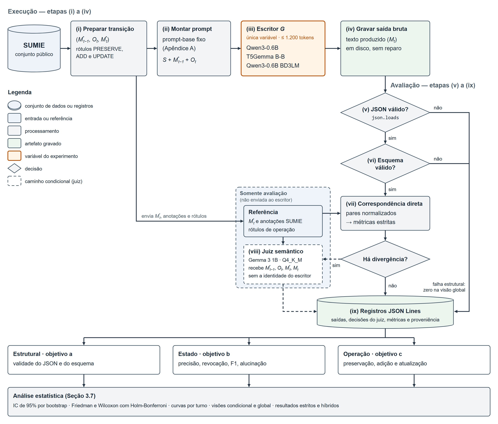
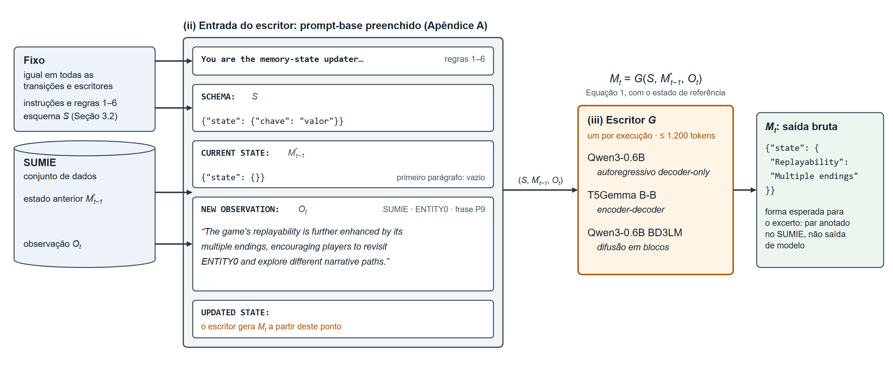

# Arquitetura do harness

## Diagramas da proposta

A Figura 1 do artigo (Seção 4.2) mostra a visão geral: uma transição do SUMIE percorre as etapas (i)–(iv) de execução e (v)–(ix) de avaliação. As decisões estruturais aparecem explicitamente, e o juiz é acionado apenas quando há divergência. As métricas são ligadas aos objetivos a, b e c e à análise estatística da Seção 3.7. A referência ($M_t^*$, anotações e rótulos) segue por um caminho separado e nunca é enviada ao escritor. O estado gerado também não realimenta o turno seguinte.



[Fonte vetorial editável da Figura 1](../07_Artigo_TCC/diagramas_pesquisa/fig1_harness_visao_geral.svg).

A Figura 2 detalha as etapas (ii) e (iii). O *prompt-base* preenchido é a própria entrada do escritor, $(S, M_{t-1}^*, O_t)$: o texto de instrução e o esquema $S$ são fixos, e $M_{t-1}^*$ e $O_t$ vêm do SUMIE a cada transição. Um escritor por execução completa `UPDATED STATE` com o JSON completo. O exemplo foi conferido no conjunto público: `ENTITY0` é o nome mascarado da entidade, P9 é o `sentence_id` da frase (citada literalmente) e a saída mostrada é o par anotado `Replayability: Multiple endings`, não a saída de um modelo. O experimento usa o parágrafo integral.



[Fonte vetorial editável da Figura 2](../07_Artigo_TCC/diagramas_pesquisa/fig2_harness_escrita.svg).

As duas figuras são geradas por [gerar_figuras_harness.py](../07_Artigo_TCC/diagramas_pesquisa/gerar_figuras_harness.py) (SVG e, com Chrome *headless*, PNG). As justificativas das alterações estão em [justificativa_ajustes_secao_4_2.md](../07_Artigo_TCC/justificativa_ajustes_secao_4_2.md).

### Referências para a representação

- [Moody (2009), *The "Physics" of Notations*](https://doi.org/10.1109/TSE.2009.67): princípios de distinção perceptível e transparência semântica para notações de engenharia de software. Aqui, formas, rótulos e setas distinguem dados, processamento e armazenamento sem depender apenas de cor.
- [Hwang et al. (2024), *Enhancing Incremental Summarization with Structured Representations*](https://aclanthology.org/2024.findings-emnlp.220/): a Figura 2 apresenta separadamente esquema, memória, informação nova e geração em sumarização estruturada. A Figura 2 deste projeto é uma representação original do protocolo GU-JSON, não uma reprodução daquela figura nem do fluxo CoK-JSON.
- [Hwang et al. (2025), *SUMIE: A Synthetic Benchmark for Incremental Entity Summarization*](https://aclanthology.org/2025.coling-main.721/): fundamento dos dados e das anotações; o exemplo foi conferido no [conjunto público SUMIE](https://github.com/google-deepmind/sumie).
- [Correia et al. (2024), *Towards Living Software Architecture Diagrams*](https://arxiv.org/abs/2407.17990): pré-publicação sobre manter diagramas atualizáveis a partir de artefatos e edições. Os SVGs acima são fontes editáveis mantidas manualmente; não há recuperação automática da arquitetura neste projeto.

## Componentes

```text
Dataset Adapter
      ↓
Transition Stream
      ↓
Prompt Builder
      ↓
Memory Writer Adapter
      ↓
Raw Output Logger
      ↓
JSON Parser
      ↓
Schema Validator
      ↓
State Evaluator
      ↓
Result Store
```

## Interface comum do writer

Pseudo-interface:

```python
class MemoryWriter:
    def update(
        self,
        schema: dict,
        previous_state: dict,
        observation: str,
        max_output_tokens: int
    ) -> str:
        ...
```

Cada arquitetura implementa o mesmo contrato.

O contrato é a reescrita integral GU-json de [[06_Referencias/referencias#Hwang et al. — structured incremental summarization|Hwang et al., 2024]], não o mecanismo de revisões programáticas de [[06_Referencias/referencias#PRISM|PRISM, 2025]]. O adapter de dados deve respeitar as políticas distintas de SUMIE e FactConsolidation-SH, conforme [[02_Metodologia/03_datasets|Datasets]].

## Adapters

```text
QwenARWriter
T5GemmaWriter
QwenDiffusionWriter
```

## Regra crítica

O adapter pode adaptar APIs técnicas, mas **não deve alterar semanticamente o prompt** para favorecer um modelo.

Se templates especiais forem obrigatórios, documentar:

- template;
- role markers;
- BOS/EOS;
- generation parameters.

Caracterizar os adapters com os relatórios e cartões de [[06_Referencias/referencias#Qwen3 Technical Report|Qwen3]] e [[06_Referencias/referencias#T5Gemma|T5Gemma]]. [[06_Referencias/referencias#Block Diffusion|Block Diffusion]] fundamenta BD3LM, mas o checkpoint Qwen exato e sua API continuam pendentes. Fixar o modo thinking e registrar parâmetros específicos sem alegar equivalência de treinamento ou decoding.

## Logging

Salvar sempre:

```text
experiment_id
dataset
sample_id
turn
writer
seed
prompt_hash
raw_prompt
raw_output
parsed_json
expected_json
error
```

## Estrutura sugerida de código

```text
src/
  datasets/
  writers/
  prompts/
  schemas/
  evaluation/
  
  cli/
configs/
results/
tests/
```
