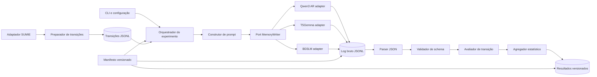
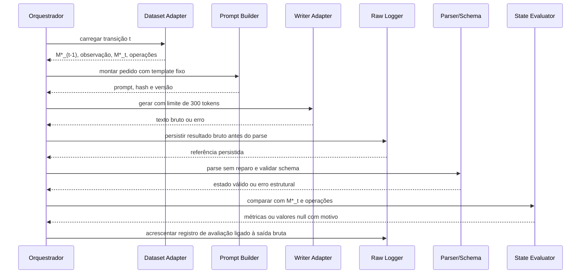

# Plano de aprimoramento da arquitetura de software do harness

## 1. Objetivo

Evoluir o rascunho de arquitetura do experimento GU-JSON para um sistema executável, testável e reproduzível que compare escritores de memória no SUMIE. Este documento é um plano de trabalho; não afirma que o código, os diagramas ou os testes aqui descritos já existam.

O protocolo de referência é o artigo atualizado em [07_Artigo_TCC](../07_Artigo_TCC/artigo_tcc_unitins_atualizado/artigo_tcc_unitins_atualizado.md). A arquitetura deve manter o escopo experimental declarado: a cada transição, os três escritores recebem a mesma observação e o estado-ouro anterior; a geração tem limite de 300 tokens; a saída bruta é preservada; não há reparo automático antes das métricas principais.

## 2. Estado atual e lacunas

A nota [01_arquitetura_harness](01_arquitetura_harness.md) já propõe um fluxo linear, uma interface informal `MemoryWriter` e o registro de dados importantes. A nota [03_formato_dados](03_formato_dados.md) exemplifica registros JSON, e [04_pipeline_avaliacao](04_pipeline_avaliacao.md) descreve parse, schema, métricas e agregação. Esses documentos estão em rascunho e ainda não definem contratos completos nem demonstram execução.

Lacunas a resolver antes da coleta principal:

- não há diagrama de arquitetura e sequência incorporado ao projeto;
- não estão separados o orquestrador, os ports/interfaces e os adapters de dados/modelos;
- os contratos de entrada e saída não definem erros, versões, identificadores e proveniência;
- a persistência ainda não especifica atomicidade, retomada, prevenção de sobrescrita e ligação entre saída bruta e métrica;
- o checkpoint exato do escritor BD3LM e sua interface de inferência ainda precisam ser confirmados;
- as regras de canonicalização e de avaliação semântica exigem validação no piloto;
- falta evidência de testes de contrato, integração e execução nos recursos de hardware disponíveis.

## 3. Princípios arquiteturais

1. **Monólito modular local:** executar o experimento em uma aplicação Python local, sem introduzir API web, banco de dados remoto, filas ou serviços distribuídos que não sejam necessários ao protocolo.
2. **Orquestração separada dos adapters:** o fluxo experimental depende de interfaces estáveis; detalhes de SUMIE, bibliotecas e checkpoints ficam atrás de adapters.
3. **Uma transição por unidade de isolamento:** erro em uma amostra deve ser registrado e não apagar resultados de outras transições.
4. **Rastreabilidade imutável:** preservar prompt e saída brutos, parâmetros, identificadores e erros; resultados derivados apontam para esses registros.
5. **Mesmo contrato experimental:** adapters podem implementar templates técnicos necessários, mas não podem mudar o significado do prompt ou as regras por modelo.
6. **Sem correção silenciosa:** JSON inválido permanece inválido na avaliação primária; parse tolerante ou reparo só pode existir em diagnóstico separado e identificado.
7. **Falha explícita em pendências:** impedir a coleta principal enquanto checkpoint, configuração ou protocolo essencial estiver indefinido.

## 4. Componentes propostos

| Componente | Responsabilidade | Entrada principal | Saída principal |
| --- | --- | --- | --- |
| CLI e configuração | Validar comandos, selecionar conjunto, escritores, limites e diretórios | Argumentos e arquivo de configuração | `ExperimentConfig` validado |
| Manifesto do experimento | Fixar protocolo, versões, hashes, parâmetros e ambiente | Configuração aprovada e dados dos modelos | `experiment_manifest.json` imutável |
| Adaptador SUMIE | Ler a partição declarada e validar estrutura/licença | Arquivos originais do SUMIE | Registros de entidade e parágrafo |
| Preparador de transições | Construir estado-ouro anterior, observação, esperado e operações | Registros SUMIE | `Transition` em JSONL |
| Construtor de prompt | Aplicar template-base e serializar schema/estado/observação | `Transition` e versão do prompt | Texto do prompt e hash |
| Orquestrador | Executar transições nos writers sob os mesmos dados e políticas | Configuração e fluxo de transições | Resultados por escritor e transição |
| Interface `MemoryWriter` | Definir contrato comum de geração | Pedido de geração | `GenerationResult` bruto e metadados |
| Adapters de writer | Adaptar runtime, template e parâmetros para Qwen AR, T5Gemma e BD3LM | Pedido comum | Texto bruto do modelo ou erro tipado |
| Persistência bruta | Gravar prompt, saída, tempos e exceções antes da avaliação | `GenerationResult` | JSONL somente acrescentável |
| Parser JSON | Interpretar exclusivamente a saída bruta | Texto gerado | Estado parseado ou erro sintático |
| Validador de schema | Verificar forma e tipos exigidos | Estado parseado | Resultado de validação e detalhes |
| Canonicalizador | Converter estados em unidades comparáveis sem equivalência semântica implícita | Estado esperado e predito | Pares caminho-valor normalizados |
| Avaliador de transição | Calcular validade, fidelidade e operações | Esperado, predito, anotação de operação | `EvaluationRecord` |
| Agregador estatístico | Calcular resumos, bootstrap e comparações pareadas | Registros de avaliação | Tabelas e dados para gráficos |
| Exportador de relatório | Materializar CSV/JSON e gráficos com proveniência | Agregados e manifesto | Artefatos de resultados versionados |

### 4.1 Interfaces mínimas

Definir modelos tipados para os contratos abaixo antes de implementar os adapters. Os nomes são conceituais; a implementação pode escolher dataclasses ou modelos Pydantic já adotados pelo repositório.

```text
Transition
  experiment_id, dataset_version, split, sample_id, entity_id, turn
  previous_state, observation, expected_state, operations

WriterRequest
  transition_id, prompt, schema, max_output_tokens, generation_config

GenerationResult
  transition_id, writer_id, raw_output, elapsed_ms
  model_revision, runtime_metadata, seed, error

EvaluationRecord
  transition_id, writer_id, raw_output_ref
  json_valid, schema_valid, precision, recall, state_f1
  hallucination_rate, preservation_accuracy, add_accuracy, update_accuracy
  evaluation_errors, evaluator_version
```

Campos não aplicáveis devem ser `null`, acompanhados de motivo, em vez de serem convertidos em sucesso ou falha artificial. Estados e prompts precisam preservar a ordem ou forma original quando isso for necessário para reprodução; canonicalização ocorre somente na etapa de avaliação.

## 5. Arquitetura lógica



O diagrama representa a arquitetura pretendida. O artefato final deve ser atualizado para refletir os módulos implementados, não mantido como desenho ideal desconectado do código.

## 6. Fluxo de uma transição



Ao executar os três writers, o orquestrador deve fornecer exatamente a mesma transição e versão de prompt. A execução pode ser sequencial para respeitar a memória da GPU; isso não altera o desenho pareado.

## 7. Decisões e registros de arquitetura

Criar um registro curto de decisão (ADR) para cada item abaixo, incluindo contexto, opções, decisão, consequências e responsável pela confirmação:

- **ADR-01 — Estratégia de execução:** CLI local, execução sequencial e retomada por transição concluída.
- **ADR-02 — Persistência:** JSONL append-only para transições, saídas brutas, erros e avaliações; política de identificadores e de não sobrescrita.
- **ADR-03 — Checkpoints e runtimes:** URI, revisão/hash, tokenizer, runtime, precisão e parâmetros de cada writer. O BD3LM fica bloqueado até identificação inequívoca.
- **ADR-04 — Orçamento:** limite de 300 tokens de saída e janela de entrada até 8.192 tokens; registrar tokens reais e condição de truncamento por adapter.
- **ADR-05 — Avaliação:** canonicalização, igualdade por campo, casos ambíguos, estado vazio, denominador zero, JSON inválido e schema inválido.
- **ADR-06 — Reprodutibilidade:** seed quando aplicável, hash do prompt e dos dados, versões de bibliotecas, sistema operacional e hardware.
- **ADR-07 — Privacidade e licença:** armazenamento local, origem/licença do SUMIE e dos modelos, e política para logs contendo entradas do dataset.

Não fixar decisão científica apenas por conveniência de implementação. Mudança de prompt, operação, métrica ou checkpoint deve atualizar protocolo, manifesto e documentação do artigo antes da coleta principal.

## 8. Organização inicial do código

```text
src/
  harness/
    cli.py
    config.py
    orchestrator.py
    manifest.py
  datasets/
    sumie.py
    transitions.py
  prompts/
    base.py
  writers/
    protocol.py
    qwen_ar.py
    t5gemma.py
    bd3lm.py
  evaluation/
    json_output.py
    schema.py
    canonicalization.py
    transition_metrics.py
    statistics.py
  storage/
    jsonl.py
  reporting/
    tables.py
    plots.py
configs/
  experiment.yaml
schemas/
  memory-state.schema.json
prompts/
  gu_json_v1.txt
results/
  manifests/
  raw/
  evaluations/
  aggregates/
tests/
  unit/
  contract/
  integration/
```

Manter artefatos pesados, checkpoints, dados sujeitos a licença e resultados crus fora do controle de versão quando necessário. Versionar código, esquemas, configuração não sensível, manifesto e documentação necessária para reproduzir o experimento.

## 9. Plano de implementação e critérios de aceite

### Fase 0 — Fechar decisões que bloqueiam o desenho

**Tarefas:** confirmar a pergunta e escopo; localizar o checkpoint BD3LM exato; verificar licença e acesso ao SUMIE; confirmar orçamento computacional e versões dos runtimes.

**Aceite:** manifesto preliminar identifica os três modelos por revisão imutável, ou registra decisão explícita de substituição aprovada pelo orientador; todos os três carregam em smoke test ou há plano de contingência aprovado.

### Fase 1 — Contratos e diagramas

**Tarefas:** definir `Transition`, `WriterRequest`, `GenerationResult` e `EvaluationRecord`; aprovar as decisões de avaliação; atualizar diagramas de componentes e sequência com os contratos reais.

**Aceite:** exemplos JSON válidos; nenhuma ambiguidade sobre estado-ouro por turno, regra SUMIE de perspectivas, erro de parse ou relação entre registro bruto e avaliação.

### Fase 2 — Esqueleto executável

**Tarefas:** criar CLI, configuração validada, identificador de execução, manifesto, logging e armazenamento JSONL append-only.

**Aceite:** comando de execução processa fixtures; falha não sobrescreve saída anterior; retomada não duplica registros; cada linha é vinculável a `experiment_id` e `transition_id`.

### Fase 3 — Dados e transições

**Tarefas:** implementar adapter SUMIE; preparar estado anterior, observação, estado esperado e operações; validar divisão de dados e contagens.

**Aceite:** transições determinísticas com IDs estáveis; contagens por entidade, turno e operação registradas; amostra revisada manualmente e estados-ouro sem truncamento no orçamento definido.

### Fase 4 — Writers

**Tarefas:** implementar e testar os três adapters sob o contrato comum; registrar templates e configurações técnicas; garantir mesma instrução semântica.

**Aceite:** cada adapter devolve texto bruto ou erro tipado, registra tempo e metadados e respeita os limites; testes de contrato passam com entradas sintéticas; inferência mínima funciona no hardware-alvo.

### Fase 5 — Validação e métricas

**Tarefas:** implementar parser sem reparo, validador de schema, canonicalizador e métricas por transição/operação; validar os casos de borda.

**Aceite:** testes cobrem JSON malformado, schema inválido, estado vazio, duplicatas, paráfrases/canonicalização, denominador zero e operações sem exemplos; resultado bruto é preservado em todas as falhas.

### Fase 6 — Integração e piloto

**Tarefas:** executar as 15 transições sintéticas e o piloto separado de 25 entidades descrito no artigo; verificar tempos, memória e truncamento; revisar ambiguidades de rótulo.

**Aceite:** pipeline de ponta a ponta reproduzível, artefatos e logs rastreáveis, relatório de bugs resolvidos, regras de canonicalização congeladas antes do experimento principal.

### Fase 7 — Coleta principal e relatório

**Tarefas:** congelar manifesto, executar os três writers na mesma partição/transições, agregar por entidade preservando dependência longitudinal e gerar tabelas/gráficos.

**Aceite:** hashes e configurações documentados; nenhuma saída bruta perdida; métricas reconstituíveis dos registros; bootstrap e testes pareados reproduzíveis; conclusões limitadas ao desenho com estado-ouro anterior.

## 10. Estratégia de testes

- **Unitários:** construção de transições, hash do prompt, parse, schema, canonicalização, rotulagem de operações e cada métrica.
- **Contrato dos writers:** mesma estrutura de pedido/resposta, limite de tokens, metadados e tratamento de exceções.
- **Integração:** fixture sintética percorre adapter de dados, prompt, writer falso, armazenamento e avaliação.
- **Smoke tests de modelo:** um caso controlado por checkpoint e registro de memória/latência, sem usar esse resultado como evidência científica.
- **Reprodutibilidade:** executar a mesma fixture em duas execuções e comparar campos determinísticos e artefatos esperados.
- **Regressão de protocolo:** detectar alteração de prompt, schema, dados ou parâmetros em relação ao manifesto congelado.

## 11. Riscos e mitigação

| Risco | Consequência | Mitigação |
| --- | --- | --- |
| Checkpoint BD3LM ou API indefinido | Comparação inviável ou não reproduzível | Bloquear coleta até confirmar ID, revisão, licença e smoke test; submeter substituição ao orientador |
| Memória/tempo insuficientes | Piloto ou coleta não termina no calendário | Medir consumo e latência por modelo; executar sequencialmente; estabelecer contingência documentada |
| Labels SUMIE ambíguos | Métricas não representam a tarefa | Auditar amostra com regras de operação explícitas e validação humana antes de congelar |
| Canonicalização textual estrita | Paráfrases corretas contam como erro | Fazer estudo piloto, reportar a adaptação e evitar chamá-la de reprodução direta da métrica semântica original |
| Falha estrutural interrompe lote | Transições sem resultado | Isolar cada transição, persistir bruto/erro e continuar sem corrigir a saída principal |
| Alteração de prompt ou dados durante coleta | Comparação inválida | Hashes e manifesto congelado; nova condição recebe novo `experiment_id` |
| Confusão entre estado-ouro e memória encadeada | Conclusão extrapolada | Rotular claramente o modo avaliado e manter erro acumulado como trabalho futuro, salvo extensão aprovada |

## 12. Perguntas em aberto para orientação

1. O produto de software será exclusivamente o harness experimental, ou há outro sistema que precisa ser implementado?
2. Qual é o checkpoint BD3LM exato e ele está disponível para o hardware planejado?
3. Qual artefato de estado acumulado será considerado referência e quem validará os casos ambíguos?
4. A coleta principal usará todos os exemplos do split declarado ou uma amostra? Qual é o critério para essa decisão?
5. A canonicalização determinística é aceitável como métrica principal, com validação amostral, ou precisa de avaliador semântico complementar?
6. Quais diagramas e entregáveis de arquitetura a orientação/banca exige para o marco acadêmico atual?
7. O calendário permite concluir smoke tests, piloto, coleta, análise, redação e revisão sem sacrificar a validade do experimento?

## 13. Próximo passo recomendado

Antes de implementar todos os módulos, realizar a **Fase 0**: resolver o identificador do BD3LM e executar um smoke test técnico dos três writers. Em paralelo, submeter ao orientador o escopo do produto e os diagramas propostos. Com essas decisões aprovadas, congelar contratos e construir o caminho vertical mínimo: uma transição SUMIE sintética, um writer substituível, persistência bruta, parse/schema e uma métrica reproduzível.
