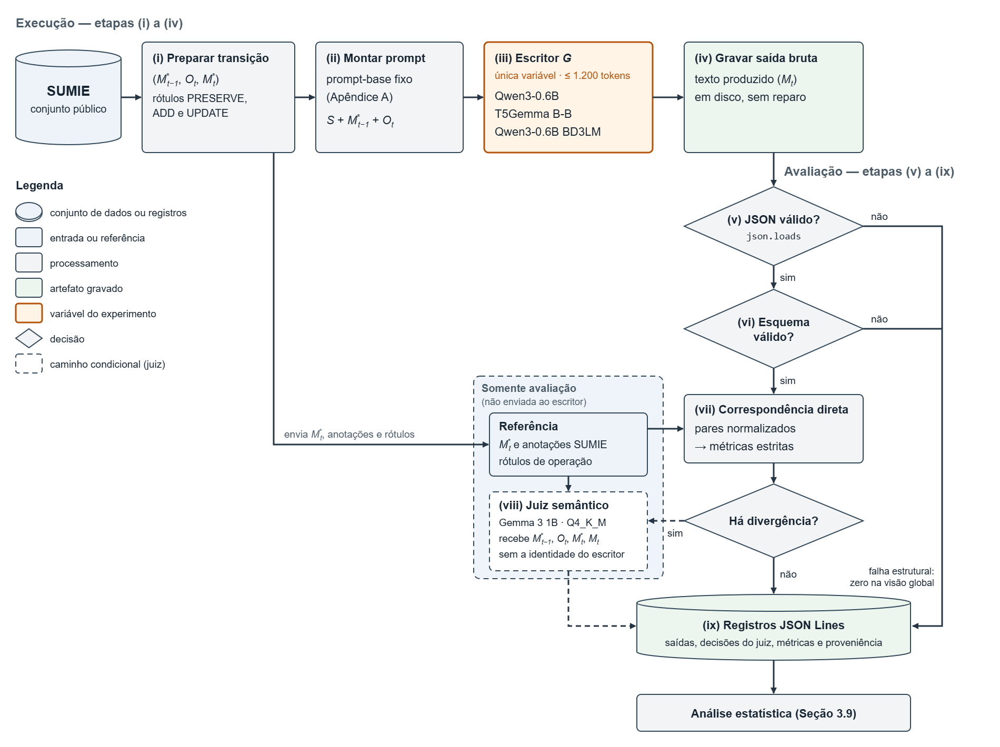
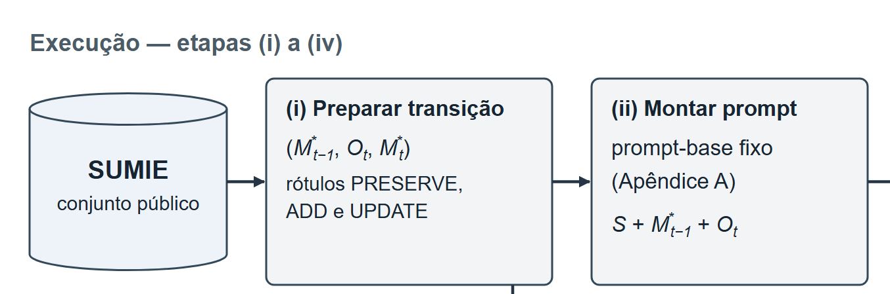
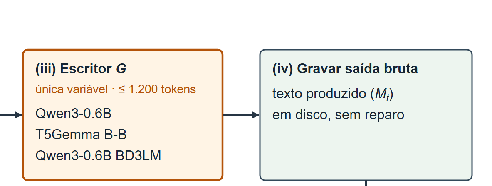
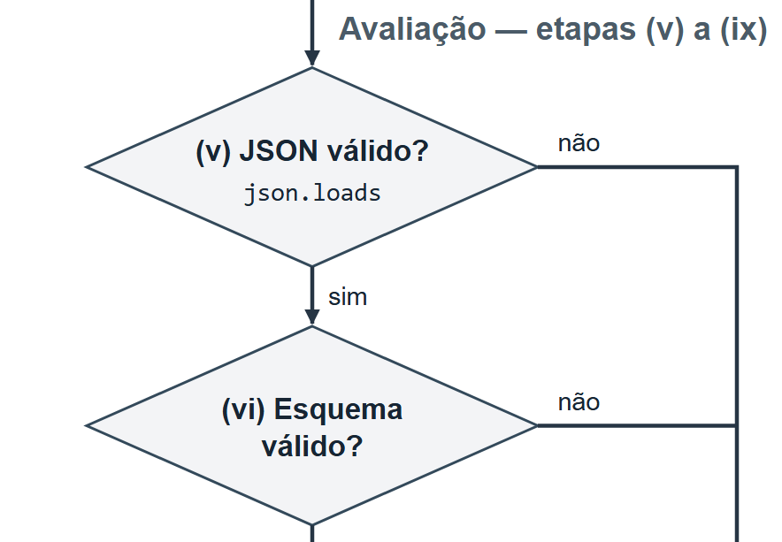
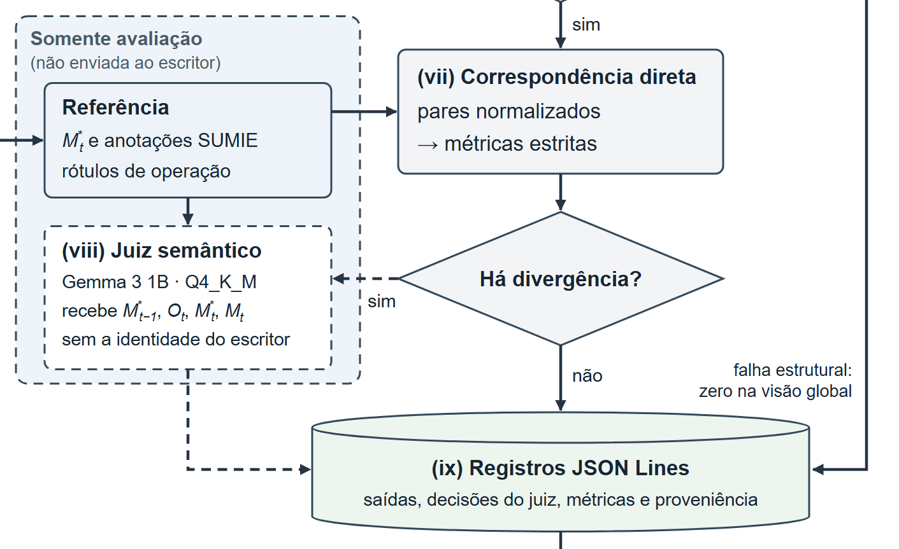
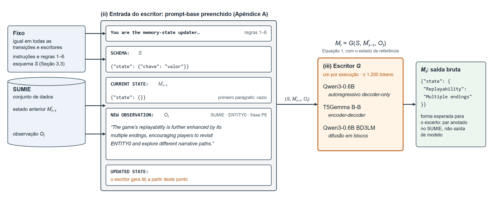

**UNIVERSIDADE ESTADUAL DO TOCANTINS – UNITINS**

**CAMPUS DE PALMAS – TO**

**CURSO DE BACHARELADO EM SISTEMAS DE INFORMAÇÃO**

GUILHERME HENRIQUE SIQUEIRA LOPES

**MODELOS DE LINGUAGEM COMPACTOS COMO ESCRITORES DE MEMÓRIA: AVALIAÇÃO DA ATUALIZAÇÃO INCREMENTAL DE ESTADOS JSON PARA AGENTES**

PALMAS/TO

2026

UNIVERSIDADE ESTADUAL DO TOCANTINS – UNITINS

CURSO DE BACHARELADO EM SISTEMAS DE INFORMAÇÃO

GUILHERME HENRIQUE SIQUEIRA LOPES

**MODELOS DE LINGUAGEM COMPACTOS COMO ESCRITORES DE MEMÓRIA: AVALIAÇÃO DA ATUALIZAÇÃO INCREMENTAL DE ESTADOS JSON PARA AGENTES**

Trabalho de Conclusão de Curso apresentado ao Curso de Sistemas de Informação da Universidade Estadual do Tocantins – UNITINS como parte dos requisitos para a obtenção do grau de Bacharel em Sistemas de Informação, sob a orientação do professor Me. Alex Coelho.

**Orientador:** Prof. Me. Alex Coelho

PALMAS/TO

2026

**RESUMO**

Modelos de linguagem que operam em múltiplas etapas dependem de um estado persistente para registrar as informações recebidas incrementalmente. Representar esse estado como um *checkpoint* (registro persistente de estado) em JSON (*JavaScript Object Notation*), atualizado pelo método *Generate-Update* em JSON (GU-JSON), explicita atributos e valores sob memória limitada, mas exige que o modelo escritor reescreva toda a estrutura a cada turno, expondo o estado a falhas sintáticas, omissão de fatos válidos, alterações indevidas ou alucinações. Embora modelos de linguagem compactos sejam candidatos naturais a executar essa operação localmente com menor custo, na revisão realizada, não se identificou uma comparação entre representantes compactos de diferentes paradigmas gerativos nessa tarefa. Este trabalho compara três representantes compactos — Qwen3-0.6B (autoregressivo *decoder-only*), T5Gemma B-B (*encoder-decoder*) e Qwen3-0.6B BD3LM (difusão em blocos) — atuando exclusivamente como escritores de memória no método GU-JSON. O experimento controlado utiliza as sequências de sumarização incremental de entidades do conjunto de referência (*benchmark*) SUMIE (*A Synthetic Benchmark for Incremental Entity Summarization*), mantendo constantes o esquema JSON, o *prompt* *zero-shot* (instrução fornecida ao modelo sem exemplos de demonstração) e o orçamento de saída de 1.200 *tokens* (unidades textuais processadas pelo modelo) na comparação dos modelos escritores. A qualidade de cada transição será avaliada pela validade sintática do JSON e sua conformidade com o esquema; pela fidelidade das informações ao longo dos turnos, considerando omissões e acréscimos indevidos; e pelo desempenho na preservação, adição e atualização de informações.

**Palavras-chave:** Memória de agentes. *Checkpoint* JSON. Modelos de linguagem compactos. Sumarização incremental.

**ABSTRACT**

*Compact language models as memory writers: evaluating incremental updates of JSON checkpoints for agents*

Language-model-based agents operating across multiple steps rely on a persistent state to record information received incrementally. Representing this state as a JSON checkpoint updated through the Generate-Update in JSON (GU-JSON) method makes attributes and values explicit under limited memory, but requires the writer model to regenerate the entire structure at every turn, exposing the state to syntactic failures, omission of valid facts, unintended modifications or hallucinations. Although compact language models are natural candidates to perform this operation locally at lower cost, prior work has validated GU-JSON only with large models and has not yet compared how compact models from distinct generative paradigms behave in this role. This study compares three compact representatives — Qwen3-0.6B (autoregressive decoder-only), T5Gemma B-B (encoder-decoder) and Qwen3-0.6B BD3LM (block diffusion) — acting exclusively as memory writers under the GU-JSON method. The controlled experiment uses the incremental entity summarization sequences from the SUMIE benchmark, holding the JSON schema, zero-shot prompt and 1,200-token output budget constant while comparing the writer models. Transition quality will be evaluated through JSON syntactic validity and schema compliance; state precision, recall, F1 and hallucination rate across turns; and preservation, addition and update accuracies stratified by operation type, using paired comparisons.

**Keywords:** Agent memory. JSON checkpoint. Small language models. Incremental summarization.

**LISTA DE ILUSTRAÇÕES**

Figura 1 – Visão geral do harness experimental para uma transição do SUMIE 30

Figura 2 – Etapa de escrita do checkpoint (etapas ii e iii) 36

**LISTA DE QUADROS E TABELAS**

Quadro 1 – Comparação entre trabalhos relacionados e a proposta 17

Quadro 2 – Consultas da revisão sistemática no arXiv 23

Quadro 3 – Variáveis do experimento 24

Quadro 4 – Etapas do harness, tecnologias e artefatos produzidos 35

Quadro 5 – Métricas de avaliação do experimento 38

Quadro 6 – Matriz de rastreabilidade entre objetivos específicos, artefatos e evidências 41

Tabela 1 – Cronograma de atividades para TCC I e II, com subdivisão quinzenal indicando tarefas realizadas e planejadas ao longo dos dois semestres. 45

Quadro 7 – Artefatos da revisão sistemática 53

**LISTA DE ABREVIATURAS E SIGLAS**

**ABNT –** Associação Brasileira de Normas Técnicas

**AR –** Autoregressivo (Autoregressive)

**BD3LM –** Block Discrete Denoising Diffusion Language Model (Difusão em Blocos)

**CoK-JSON –** Chain-of-Key em JSON

**GM –** Generate-Merge

**GO –** Generate-Once

**GU-JSON –** Generate-Update em JSON

**IC –** Intervalo de Confiança

**JSON –** JavaScript Object Notation

**LLM –** Large Language Model (Modelo de Linguagem de Grande Porte)

**PA –** Preservation Accuracy (Acurácia de Preservação)

**SLM –** Small Language Model (Modelo de Linguagem Compacto)

**SUMIE –** Synthetic Benchmark for Incremental Entity Summarization

**UA –** Update Accuracy (Acurácia de Atualização)

**UNITINS –** Universidade Estadual do Tocantins

**SUMÁRIO**

**1 INTRODUÇÃO 8**

**2 REFERENCIAL TEÓRICO 11**

2.1 Harness de agentes e gerenciamento de memória 11

2.2 Representação estruturada da memória 11

2.3 Atualização incremental e o método Generate-Update em JSON 12

2.4 Avaliação de memória e de atualização de conhecimento 13

2.5 Geração estruturada: validade sintática e conformidade com esquema 14

2.6 Paradigmas gerativos e modelos de linguagem compactos 15

2.7 Comparação estatística de modelos 20

2.8 Trabalhos relacionados 16

**3 MATERIAIS E MÉTODOS 20**

3.1 Revisão sistemática da literatura 21

3.2 Desenho experimental e variáveis 24

3.3 Método de memória, esquema e prompt 25

3.4 Conjunto de dados e preparação das transições 26

3.5 Modelos avaliados 27

3.6 Ambiente de execução e harness experimental 28

3.7 Arquitetura do harness 29

3.8 Métricas de avaliação 36

3.9 Procedimento experimental e plano de análise 40

3.10 Rastreabilidade entre objetivos, experimentos e evidências 41

3.11 Limitações metodológicas e ameaças à validade 41

3.12 Resultados e contribuições esperadas 42

3.13 Cronograma 43

**4 CONSIDERAÇÕES FINAIS 46**

**REFERÊNCIAS 48**

**APÊNDICE A – PROMPT-BASE DO ESCRITOR DE MEMÓRIA 52**

**APÊNDICE B – ARTEFATOS DA REVISÃO SISTEMÁTICA 53**

# **1 INTRODUÇÃO**

Agentes baseados em modelos de linguagem executam tarefas de múltiplas etapas, nas quais novas observações chegam de forma sequencial e as decisões subsequentes dependem das informações registradas em turnos anteriores (Hu; Wang; McAuley, 2025). O gerenciamento de memória envolve a geração, a atualização e a recuperação de informações relevantes (Zeng et al., 2024).

Nesses fluxos, a manutenção de um estado persistente e consistente condiciona diretamente a confiabilidade operacional do sistema (Muhoberac et al., 2025). Por essa razão, *benchmarks* recentes passaram a avaliar a memória de agentes sob interações incrementais e de longo alcance, examinando a capacidade de reter fatos relevantes, integrar novas evidências e lidar com atualizações ao longo de múltiplos turnos (Hu; Wang; McAuley, 2025; Maharana et al., 2024; Wu et al., 2024).

Como o acúmulo irrestrito do histórico de interações rapidamente excede ou degrada o uso da janela de contexto, uma abordagem recorrente consiste em consolidar as observações em uma representação estruturada persistente. Em tarefas de sumarização incremental com orçamento restrito de memória, Hwang et al. (2024) demonstraram que o método *Generate-Update* em JSON (GU-JSON) — no qual o modelo recebe o estado anterior e a nova observação e regenera o objeto JSON atualizado — alcança maior fidelidade que a atualização equivalente em texto livre. O uso de um *checkpoint* JSON explicita os pares de atributo e valor armazenados e permite inspecionar o estado de forma direta a cada transição (Jayalath et al., 2025; Yuen et al., 2025). Entretanto, como o método exige reescrever integralmente o objeto a cada etapa, o componente responsável pela escrita (*memory writer*) torna-se um ponto crítico de falha: a atualização pode tanto corromper a sintaxe do JSON ou violar o esquema estipulado (Geng et al., 2025) quanto omitir fatos ainda válidos, alterar valores indevidamente ou introduzir informações sem respaldo na entrada.

Uma vez que a reescrita do *checkpoint* ocorre repetidamente a cada turno de interação, delegar essa operação a modelos de grande porte eleva o custo computacional e a latência do agente. Modelos de linguagem compactos (*small language models*, SLMs), que viabilizam execução local e menor consumo de recursos em subtarefas bem delimitadas e restritas por esquema (Lu et al., 2025; Sharma; Mehta, 2025), apresentam-se como alternativa para atuar como escritores dedicados de memória. Contudo, transformar um estado JSON anterior e uma nova observação textual em um novo objeto JSON completo impõe demandas distintas conforme o paradigma gerativo do modelo. Modelos autoregressivos *decoder-only* produzem sequências de *tokens* da esquerda para a direita (Yang et al., 2025); modelos *encoder-decoder* separam a codificação bidirecional da entrada da decodificação sequencial do novo estado (Zhang et al., 2025); e modelos de difusão em blocos combinam geração autoregressiva entre blocos com refinamento paralelo de *tokens* mascarados no interior de cada bloco (Arriola et al., 2025).

Embora a literatura investigue separadamente a organização da memória em agentes (Jayalath et al., 2025; Yuen et al., 2025; Zeng et al., 2024), a conformidade na geração de JSON (Geng et al., 2025; Mündler; Dekoninck; Vechev, 2025) e a sumarização incremental estruturada (Hwang et al., 2024; Hwang et al., 2025), o efeito do paradigma gerativo em escritores compactos de estado JSON permanece em aberto. O método GU-JSON e o *benchmark* de sumarização incremental de entidades SUMIE foram avaliados originalmente apenas com modelos proprietários de grande porte (Hwang et al., 2024; Hwang et al., 2025), ao passo que comparações recentes entre modelos autoregressivos e de difusão em fluxos agênticos concentraram-se em modelos de 7 a 8 bilhões de parâmetros operando sobre memória em texto livre (Lu et al., 2026). Estudos recentes já empregam modelos compactos como extratores ou gestores de memória estruturada, mas por meio de operações sobre registros e sem comparar paradigmas gerativos (Hwang; Diao, 2026; Kang et al., 2026). Não se identificou, na revisão sistemática realizada (Seção 3.1), uma comparação controlada entre representantes compactos de paradigmas gerativos distintos atuando exclusivamente como escritores de um mesmo *checkpoint* JSON sob orçamento fixo de *tokens*.

Diante dessa lacuna, este trabalho busca responder à seguinte pergunta de pesquisa: como representantes compactos dos paradigmas autoregressivo *decoder-only*, *encoder-decoder* e de difusão em blocos diferem na qualidade da atualização incremental de *checkpoints* pelo método GU-JSON no *benchmark* SUMIE, sob esquema e limite de memória fixos?

O objetivo geral é comparar a qualidade da atualização incremental de *checkpoints* JSON produzida pelos modelos compactos Qwen3-0.6B (*decoder-only*), T5Gemma B-B (*encoder-decoder*) e Qwen3-0.6B BD3LM (difusão em blocos), atuando como escritores de memória no método GU-JSON, no *benchmark* SUMIE e sob condições experimentais controladas. Para alcançá-lo, definem-se três objetivos específicos:

1. avaliar a conformidade estrutural dos *checkpoints* produzidos por cada escritor a partir das taxas de validade sintática do JSON e de aderência ao esquema ao longo das transições;
2. comparar a fidelidade do estado mantido por cada escritor ao longo dos turnos de atualização do SUMIE, utilizando precisão, revocação, F1 do estado e taxa de alucinação;
3. analisar o perfil de erro dos escritores segundo o tipo de operação exigida no SUMIE, contrastando a preservação de atributos inalterados com a adição e a atualização de informações.

O restante deste artigo está organizado da seguinte forma: a seção 2 apresenta a revisão bibliográfica sobre *harness*, memória persistente estruturada em agentes e os trabalhos relacionados; a seção 3 detalha os materiais e métodos, incluindo a revisão sistemática, o protocolo experimental e a arquitetura do *harness*, além de apresentar os resultados esperados e o cronograma de execução; e a seção 4 apresenta as considerações finais.

# **2 REFERENCIAL TEÓRICO**

A compreensão da escrita de memória exige situá-la na arquitetura mais ampla do *harness* e examinar decisões sobre a representação e a atualização do estado, a avaliação de sua fidelidade, a conformidade sintática e a escolha do modelo gerador. As subseções a seguir contextualizam esses aspectos e sintetizam os trabalhos mais próximos da presente proposta, selecionados pelo procedimento descrito na Seção 3.1.

## **2.1 *Harness* de agentes e gerenciamento de memória**

Neste trabalho, um *harness* de agentes é definido operacionalmente como a camada de software que envolve o modelo de linguagem e organiza seu funcionamento em tarefas de múltiplas etapas. Ele seleciona o contexto, disponibiliza ferramentas e coordena a execução de ações. Essa delimitação dialoga com a arquitetura CoALA, que descreve agentes em termos de componentes de memória, espaço de ações e processo de decisão (Sumers et al., 2024).

O gerenciamento de memória integra essa camada ao organizar informações que podem ser úteis em interações posteriores. A geração ou atualização de memória produz e mantém os registros, enquanto a recuperação seleciona os conteúdos relevantes para compor o contexto de chamadas posteriores ao modelo (Sumers et al., 2024; Zeng et al., 2024). A representação adotada e a fidelidade da escrita, portanto, condicionam as informações disponíveis para recuperação.

Neste trabalho, investiga-se apenas a escrita incremental da memória, sem avaliar os métodos de recuperação nem o desempenho de um agente completo. O *harness* experimental descrito na seção 3.6 tem finalidade distinta: padronizar as entradas, a execução dos escritores e a avaliação das saídas.

## **2.2 Representação estruturada da memória**

A escolha do formato de armazenamento condiciona a capacidade do agente de reter e consultar informações ao longo de interações extensas. Ao investigar diferentes estruturas de memória em agentes, Zeng et al. (2024) identificaram vantagens distintas conforme o formato adotado, evidenciando que resumos favorecem a condensação de contextos longos e que unidades factuais explícitas favorecem a precisão na retenção de detalhes — propriedades combinadas quando o estado de uma entidade é mantido como um conjunto estruturado de pares atributo-valor, ainda que aquele estudo avalie estratégias de recuperação e não a reescrita incremental do estado.

Sistemas voltados à persistência de estado ao longo de múltiplas etapas adotam mecanismos variados para estruturar e atualizar essa memória. O PRISM organiza a memória em um esquema hierárquico tipado e realiza atualizações por meio de operações de caminho e valor validadas e aplicadas programaticamente (Jayalath et al., 2025). De forma distinta, os Intrinsic Memory Agents reescrevem a memória contextual de cada agente a partir do estado anterior e da saída mais recente, avaliando modelos de instrução manuais, genéricos e gerados pelo próprio modelo (Yuen et al., 2025). Outras arquiteturas recorrem a autômatos finitos para rastrear o estado operacional em fluxos científicos extensos, como o SciBORG (Muhoberac et al., 2025), ou priorizam a construção dinâmica de fragmentos para raciocínio em múltiplas etapas, como a Chain-of-Memory (Xu et al., 2026).

Em conjunto, esses estudos demonstram que o formato de representação da memória e o mecanismo empregado para atualizá-la constituem dimensões independentes de projeto. Enquanto abordagens como o PRISM dependem de controladores programáticos externos e sistemas multiagente avaliam apenas o desempenho na tarefa final, a adoção de um esquema JSON único e fixo permite isolar experimentalmente o processo de reescrita do estado e medir diretamente a fidelidade de cada transição.

## **2.3 Atualização incremental e o método *Generate-Update* em JSON**

Hwang et al. (2024) investigaram a manutenção de resumos incrementais sob orçamento restrito de memória, comparando as estratégias *Generate-Once* (GO), *Generate-Update* (GU) e *Generate-Merge* (GM) em representações textuais e em JSON nos conjuntos SUMIE e BooookScore, utilizando os modelos Gemini Ultra e Gemini Pro. Sob limite de *tokens*, a atualização sobre representações em JSON (GU-JSON) superou consistentemente a atualização equivalente em texto livre (GU-Text). Os autores também propuseram o *Chain-of-Key* em JSON (CoK-JSON), que decompõe a tarefa selecionando chaves específicas antes da atualização.

No método GU-JSON, a cada nova observação o modelo escritor recebe o esquema, o *checkpoint* corrente e a observação, gerando diretamente o *checkpoint* completo atualizado, conforme a Equação 1:

$$M\_{t}=G\left(S, M\_{t-1}, O\_{t}\right)  \left(1\right)$$

em que $S$ é o esquema, $M\_{t-1}$ é o *checkpoint* anterior, $O\_{t}$ é a nova observação, $G$ é o modelo escritor e $M\_{t}$ é o *checkpoint* resultante.

Para a comparação entre modelos escritores compactos, o GU-JSON apresenta uma propriedade metodológica central: ele concentra toda a operação de manutenção do estado em uma única chamada ao modelo $G$. Diferentemente de métodos que decompõem a atualização em etapas de seleção de caminhos ou aplicam modificações parciais por código externo (Hwang et al., 2024; Jayalath et al., 2025), a reescrita integral exige que o próprio modelo preserve os campos inalterados, integre as novas informações e mantenha a estrutura JSON válida simultaneamente, permitindo avaliar diretamente o comportamento do escritor sem interferência de algoritmos auxiliares de mesclagem.

## **2.4 Avaliação de memória e de atualização de conhecimento**

O *benchmark* SUMIE foi desenvolvido especificamente para avaliar a sumarização incremental de entidades a partir de sequências de parágrafos que introduzem fatos novos, repetições, informações distratoras e pontos de vista divergentes (Hwang et al., 2025). Cada parágrafo conta com anotações de atributos e valores relevantes da entidade descrita. Uma característica central do SUMIE é sua política de acumulação: como diferentes fontes ou parágrafos podem expressar perspectivas distintas sobre um mesmo atributo, o *prompt* de atualização de referência determina a preservação dos atributos prévios e a integração de visões conflitantes, sem que uma nova opinião invalide automaticamente a anterior. No estudo original, os autores observaram perfis contrastantes de precisão e revocação entre os modelos de grande porte avaliados.

Outros *benchmarks* recentes examinam a memória sob interações de múltiplos turnos, porém com foco na resposta a perguntas ao final da sequência. O MemoryAgentBench avalia quatro competências de memória — incluindo a consolidação de fatos e o esquecimento seletivo sob regras de precedência temporal (Hu; Wang; McAuley, 2025) —, enquanto o LongMemEval enfatiza a atualização de conhecimento e o raciocínio temporal em assistentes conversacionais (Wu et al., 2024), e o LoCoMo investiga diálogos muito longos distribuídos em múltiplas sessões (Maharana et al., 2024).

A análise conjunta desses *benchmarks* revela que avaliações baseadas apenas em respostas finais podem mascarar degradações progressivas do estado interno, como a perda silenciosa de atributos antigos ao longo dos turnos. Ao tomar o SUMIE como cenário experimental e inspecionar diretamente o *checkpoint* gerado em cada transição $M\_{t}$, torna-se possível quantificar separadamente a capacidade do escritor de preservar atributos existentes, adicionar novos campos e atualizar valores já presentes.

## **2.5 Geração estruturada: validade sintática e conformidade com esquema**

A utilização de JSON como formato de estado exige distinguir a correção formal da saída de sua correção semântica. O *benchmark* JSONSchemaBench demonstra que modelos de linguagem apresentam taxas não triviais de falha sintática e de violação de restrições quando submetidos a esquemas JSON de diferentes complexidades (Geng et al., 2025). Para contornar essas falhas em modelos autoregressivos, técnicas de decodificação restrita por gramática filtram *tokens* inválidos durante a inferência sem necessidade de ajuste fino (Geng et al., 2023). Mais recentemente, mecanismos análogos baseados em gramáticas livres de contexto (Mündler; Dekoninck; Vechev, 2025) e em aprendizado por reforço multiagente (Khanal et al., 2026) foram propostos para elevar a conformidade sintática em modelos de linguagem por difusão.

Na avaliação de escritores de memória, essa literatura impõe dois cuidados experimentais. Primeiro, a conformidade com o esquema é condição necessária para a leitura automatizada do estado, mas não suficiente para garantir fidelidade: um objeto JSON sintaticamente válido pode omitir atributos essenciais ou conter valores alucinados, razão pela qual métricas estruturais e semânticas devem ser apuradas de forma independente. Segundo, como os motores de decodificação restrita atuam de maneira distinta sobre a geração sequencial e sobre o refinamento iterativo por difusão, a avaliação em regime puramente instrucional (*prompt-only*) é necessária para observar a capacidade intrínseca de cada modelo de preservar a sintaxe e o conteúdo do *checkpoint*.

## **2.6 Paradigmas gerativos e modelos de linguagem compactos**

Os três paradigmas gerativos considerados neste estudo processam a relação entre entrada e saída sob princípios distintos. Modelos autoregressivos *decoder-only* fatoram a probabilidade da sequência da esquerda para a direita, gerando cada *token* condicionado ao prefixo já produzido; a família Qwen3 exemplifica esse paradigma em múltiplas escalas, incluindo modelos compactos de 0,6 bilhão de parâmetros (Yang et al., 2025). Modelos *encoder-decoder*, por sua vez, empregam um codificador com atenção bidirecional sobre toda a sequência de entrada antes de gerar a saída no decodificador; o T5Gemma obtém essa arquitetura pela adaptação de modelos *decoder-only* pré-treinados, visando combinar representação bidirecional do contexto com eficiência de inferência (Zhang et al., 2025).

Já os modelos de linguagem baseados em difusão formulam a geração como um processo iterativo de remoção de ruído sobre posições mascaradas, permitindo atualizar múltiplos *tokens* paralelamente (Nie et al., 2024), inclusive a partir da adaptação de pesos autoregressivos (Gong et al., 2024). A arquitetura de difusão em blocos (*Block Diffusion*, BD3LM) interpola ambos os mecanismos ao gerar blocos de *tokens* de maneira autoregressiva enquanto aplica difusão discreta dentro de cada bloco (Arriola et al., 2025).

O recorte em modelos compactos fundamenta-se na viabilidade de executá-los localmente com menor custo energético e financeiro (Lu et al., 2025) e na evidência de que modelos de menor escala podem atuar com eficácia em subtarefas agênticas repetitivas e bem delimitadas (Sharma; Mehta, 2025). Como a execução em hardware local frequentemente recorre à redução de precisão numérica e modelos menores apresentam maior sensibilidade à quantização agressiva (Lee et al., 2025), a comparação experimental requer padronizar e documentar as condições de precisão e inferência.

## **2.7 Comparação estatística de modelos**

Em comparações de modelos avaliados sobre as mesmas unidades, o teste de Friedman permite uma comparação global, enquanto o teste de Wilcoxon pareado pode ser usado nas comparações entre pares. Demšar (2006) discute esses testes na avaliação de algoritmos de aprendizagem. Neste estudo, a entidade do SUMIE será a unidade pareada: os resultados dos três escritores devem ser resumidos por entidade, sem tratar os turnos de uma mesma entidade como observações independentes. O teste de Friedman pressupõe independência entre entidades e resultados disponíveis para os três modelos; o Wilcoxon requer dados pareados, e sua interpretação como diferença de localização pressupõe diferenças aproximadamente simétricas.

Como as comparações entre pares envolvem testes múltiplos, o procedimento de Holm ajusta os valores *p* para controlar a probabilidade de ao menos uma rejeição falsa dentro da família de testes definida (Holm, 1979). Essa família deve ser especificada previamente. Se forem testadas três métricas primárias e os três pares de modelos para cada métrica, serão nove comparações. O nível $α=0,05$ será o limite de decisão previamente adotado, não a probabilidade de a hipótese nula ser verdadeira.

## **2.8 Trabalhos relacionados**

O Quadro 1 sintetiza os estudos mais próximos da presente pesquisa segundo a representação da memória, o mecanismo de atualização, a escala dos modelos avaliados, o objeto da avaliação e a presença de comparação entre paradigmas gerativos. Ele reúne dois grupos: os estudos de base, identificados no levantamento bibliográfico e discutidos nas seções anteriores, e os dez estudos selecionados pela revisão sistemática descrita na Seção 3.1, com primeiro depósito entre julho de 2025 e novembro de 2026.

**Quadro 1 – Comparação entre trabalhos relacionados e a proposta**

| **Trabalho** | **Representação da memória** | **Atualização** | **Modelos e escala** | **Objeto da avaliação** | **Compara paradigmas gerativos** |
| --- | --- | --- | --- | --- | --- |
| *Estudos de base* |  |  |  |  |  |
| Hwang et al. (2024) | Texto e JSON | GO, GU, GM e CoK, executados pelo próprio modelo | Gemini Ultra e Gemini Pro (grande porte) | Qualidade de resumos incrementais (SUMIE e BooookScore) | Não |
| Hwang et al. (2025) | Atributos e valores de entidades | Atualização incremental com preservação de perspectivas | Modelos de linguagem de grande porte | Precisão, revocação e F1 de atributos no resumo | Não |
| Jayalath et al. (2025) | Memória tipada hierárquica | Operações de caminho e valor aplicadas programaticamente | Modelos de contexto curto | Raciocínio de longo alcance (tarefa final) | Não |
| Yuen et al. (2025) | Memória contextual por agente (JSON em variantes específicas) | Reescrita a partir da memória anterior e da saída recente | Modelos de linguagem em sistemas multiagente | Desempenho do sistema multiagente | Não |
| Zeng et al. (2024) | Trechos, triplas, fatos atômicos, resumos e memória mista | Construção e recuperação | Modelos de linguagem de propósito geral | Desempenho de recuperação em tarefas finais | Não |
| Hu; Wang; McAuley (2025) | Diversos sistemas de memória | Interações incrementais de múltiplos turnos | Diversos agentes de memória | Respostas finais em quatro competências | Não |
| Geng et al. (2025) | Esquema JSON | Não se aplica (geração estática) | *Frameworks* de decodificação restrita | Conformidade sintática e de esquema | Não |
| *Estudos selecionados na revisão sistemática (Seção 3.1)* |  |  |  |  |  |
| Bini et al. (2025) | Fatos textuais, com operações em JSON (identificador, texto e evento) | Adaptadores especializados decidem adição, atualização e exclusão de entradas | Qwen2.5-1.5B e Gemma2-2B com adaptadores LoRA destilados | Respostas no LoCoMo, latência e eficiência | Não |
| Lu et al. (2026) (comparador) | Resumos de memória em texto livre; chamadas de ferramentas em JSON avaliadas à parte | Sumarização do histórico do agente | LLaDA-8B e Dream-7B (difusão) frente a Qwen-8B e Ministral-8B (autoregressivos), entre outros | Desempenho em fluxos agênticos e em chamadas de ferramentas | Sim, sem *checkpoint* JSON |
| Xiao et al. (2026) | Registros de preferências com tipo, categoria, valor e confiança | Retenção, adição e modificação a partir de novos diálogos | Modelos de grande porte e sistemas de memória | F1 entre a memória atualizada e uma referência humana; recuperação e uso | Não |
| Kang et al. (2026) | Entradas estruturadas extraídas de conversas | Extração passiva ou escrita seletiva, com recuperação, adiamento e descarte | MemReader-0.6B e MemReader-4B | Respostas e gestão de memória (LoCoMo, LongMemEval e HaluMem) | Não |
| Qiu et al. (2026) | Registros atômicos tipados (tempo, local, motivo e finalidade) | Atualização por dimensões e ordem temporal | Extrator Qwen3-4B ajustado ao esquema | Acurácia de respostas e eficiência de recuperação e atualização | Não |
| Wang et al. (2026) | Memórias central, episódica, semântica e procedural | Agentes por tipo adicionam, substituem, fundem e atualizam registros | Gestor de 4B baseado no Qwen3-4B e versão de 8B | Respostas e generalização | Não |
| Choi et al. (2026) | Grafo de eventos e persona com arestas tipadas | Inclusão de nós e de arestas de apoio, contradição e mudança | Qwen3-1.7B e Gemma-3-1B | Respostas e validação humana de uma amostra de arestas | Não |
| Zhao; Wu (2026) | Registro tipado de intenções futuras | Ciclo de vida controlado por código, com seleção pelo modelo | Gemma-E2B e Qwen3.5-4B, além de modelos maiores | F1 das intenções devidas e erros de atualização (PM-Bench) | Não |
| Hwang; Diao (2026) | Registros estruturados de memória pessoal | Admissão; manutenção, descarte de duplicatas ou fusão | Qwen3.5-2B como gestor | Correção das ações de escrita, redundância e recuperação | Não |
| Zhou; Xiong; Tan (2026) (comparador) | Plano intermediário textual editável | Reconstrução dos passos afetados por novas evidências | LLaDA2.0-mini (difusão) e Ling-mini-2.0 (autoregressivo de origem) | F1 de respostas em busca de múltiplos saltos e custo de geração | Sim, sem *checkpoint* JSON |
| Este trabalho | *Checkpoint* JSON de esquema fixo | GU-JSON, com reescrita integral pelo escritor | Três representantes compactos (~0,6B: autoregressivo, *encoder-decoder* e difusão em blocos) | Validade estrutural e fidelidade do estado por transição, turno e operação no SUMIE | Sim, sob protocolo controlado |

Fonte: elaborado pelo autor (2026).

Como evidencia o Quadro 1, os estudos que introduzem o GU-JSON e o SUMIE empregam modelos de grande porte, e propostas de memória estruturada como o PRISM aplicam operações programáticas em vez da reescrita integral pelo modelo. A revisão mostra que modelos de até cerca de 4 bilhões de parâmetros já atuam como extratores ou gestores de memória estruturada (Hwang; Diao, 2026; Kang et al., 2026; Qiu et al., 2026); portanto, o uso de um escritor compacto, isoladamente, não constitui lacuna. Esses estudos, porém, aplicam operações sobre registros ou grafos, e não a reescrita integral de um *checkpoint*, e são avaliados sobretudo pelas respostas finais ou pelas ações de escrita. Entre os que examinam o próprio estado, Xiao et al. (2026) avaliam a memória atualizada com modelos de grande porte, e Choi et al. (2026) verificam apenas uma amostra das arestas do grafo. As comparações entre difusão e autoregressão tratam de memória em texto livre ou de planos textuais editáveis, com modelos de 7 a 8 bilhões de parâmetros ou sem *checkpoint* JSON (Lu et al., 2026; Zhou; Xiong; Tan, 2026). No escopo examinado, nenhum estudo combina o GU-JSON, as transições do SUMIE, representantes compactos de três paradigmas gerativos e a avaliação da validade e da fidelidade por operação. Este trabalho preenche essa interseção ao manter constantes o método GU-JSON, o esquema, o orçamento de *tokens* e as sequências do SUMIE para avaliar diretamente a qualidade estrutural e semântica dos *checkpoints* produzidos pelos três escritores compactos.

# **3 MATERIAIS E MÉTODOS**

Este estudo segue um delineamento experimental, aplicado e quantitativo em Ciência da Computação, comparando o perfil de erros estruturais e semânticos de três escritores compactos de memória ao longo dos turnos e das operações de atualização do *benchmark* público SUMIE. O experimento utiliza exclusivamente dados sintéticos de acesso público e modelos de pesos abertos, sem envolver participantes humanos ou coleta e tratamento de dados pessoais. As subseções seguintes apresentam o procedimento de revisão sistemática que delimitou os trabalhos relacionados, as variáveis e hipóteses do experimento, o método GU-JSON e o *prompt* utilizado, a preparação das transições do SUMIE, os modelos avaliados, o *harness* de execução local e sua arquitetura, as métricas e o plano de análise estatística.

## **3.1 Revisão sistemática da literatura**

Os trabalhos relacionados do Quadro 1 e a lacuna enunciada na introdução foram delimitados por uma revisão sistemática do tipo mapeamento, conduzida segundo as etapas de planejamento, busca, triagem, extração e síntese propostas por Petersen; Vakkalanka; Kuzniarz (2015). O levantamento bibliográfico que deu origem aos estudos de base do Quadro 1 antecedeu a revisão; esta foi aplicada para identificar estudos recentes que pudessem aproximar-se da proposta. O procedimento seguiu os passos descritos a seguir:

1. **Planejamento e protocolo:** antes da busca, foram registrados em arquivo versionado a questão orientadora, a janela temporal, a fonte, as consultas, os critérios de classificação e os estudos de controle. A questão orientadora foi: quais estudos aproximam a escrita incremental de memória estruturada, o uso de modelos compactos, a avaliação direta do estado e a comparação entre paradigmas gerativos? A janela compreendeu os trabalhos com primeiro depósito entre 1º de julho de 2025 e 12 de novembro de 2026, data da execução;
2. **Fonte e consultas:** a busca foi realizada na API do repositório arXiv,[[1]](#footnote-1) nos campos de título e resumo, com todas as páginas de resultado recuperadas. As seis consultas do Quadro 2 combinam, cada uma, as facetas do problema, em vez de buscar cada termo isoladamente. As bases OpenAlex e Semantic Scholar foram previstas, mas recusaram as requisições por excesso de acessos (HTTP 429) e não integram a coleta;
3. **Estudos de controle:** seis estudos já conhecidos e pertinentes foram usados para diagnosticar perdas das consultas, sem serem acrescentados manualmente aos resultados. Quatro foram recuperados; *Intrinsic Memory Agents* (Yuen et al., 2025) e *Supersede* não foram;
4. **Deduplicação:** os registros das seis consultas foram unidos pelo identificador do arXiv, resultando em 158 candidatos, todos dentro da janela;
5. **Triagem por título e resumo:** cada candidato foi classificado em uma de três categorias. **Núcleo** (*CORE*) exigia estudo primário com atualização incremental de memória textual estruturada e ao menos mais uma aproximação: escritor ou gestor compacto de até cerca de 4 bilhões de parâmetros, avaliação direta da fidelidade do estado atualizado ou comparação entre paradigmas gerativos. **Contexto** (*CONTEXT*) indicava proximidade parcial ou informação insuficiente. **Exclusão** (*EXCLUDE*) abrangia estudos secundários, memória de *hardware*, modalidade principal não textual e temas sem contribuição ao problema. A triagem foi executada por um modelo de linguagem (claude-haiku-5.5, via GitHub Copilot SDK 1.0.31),[[2]](#footnote-2) com roteiro fixo e resposta validada por esquema JSON, em lotes de dez registros. Resultaram 13 estudos de núcleo, 91 de contexto e 54 exclusões;
6. **Elegibilidade com consulta ao texto:** todos os 13 estudos de núcleo e seis estudos de contexto escolhidos por proximidade foram reexaminados com consulta a trechos do texto integral, na mesma versão do arXiv recuperada pela busca. Cinco estudos de núcleo foram mantidos e oito foram excluídos. Três estudos de contexto foram reclassificados como núcleo, e dois foram mantidos como **comparadores** por compararem paradigmas gerativos em memória de agentes ou em estado de planejamento revisável, embora não cumpram todos os critérios. Cada decisão foi registrada com o motivo e a fonte consultada. Assim, dez estudos foram selecionados: oito de núcleo e dois comparadores;
7. **Extração e síntese:** de cada estudo selecionado foram extraídos a representação da memória, o mecanismo de atualização, os modelos e sua escala, o objeto da avaliação e a eventual comparação entre paradigmas gerativos. Esses campos formam as colunas do Quadro 1 (Seção 2.8), no qual os dez estudos aparecem ao lado dos estudos de base e da presente proposta.

**Quadro 2 – Consultas da revisão sistemática no arXiv**

| **Consulta** | **Faceta buscada** | **Registros** |
| --- | --- | --- |
| F1 | Memória estruturada ou estado de entidades com atualização incremental, em modelos de linguagem ou agentes | 52 |
| F2 | Modelos compactos que escrevem, extraem ou gerenciam memória | 71 |
| F3 | Modelos de difusão aplicados à memória de agentes ou a estado de planejamento editável | 2 |
| F4 | Saída JSON ou estruturada relacionada a memória, estado ou entidades, em modelos compactos ou de difusão | 10 |
| F5 | Menção explícita ao método GU-JSON ou ao SUMIE | 7 |
| F6 | Memória ou estado estruturado (tipado, com esquema ou JSON) atualizado ou rastreado por modelos pequenos | 26 |
| Total | Após a deduplicação pelo identificador do arXiv | 158 |

Fonte: elaborado pelo autor (2026).

Os artefatos da revisão — protocolo, roteiro de triagem, *scripts* em C# (.NET 10), expressões completas das consultas, respostas brutas da API com seus *hashes* SHA-256, decisões da triagem e da elegibilidade e registro de custo — estão relacionados no Apêndice B e publicados em um repositório público próprio na versão v1.0.0.[[3]](#footnote-3) Com isso. A revisão tem limitações: a busca cobriu uma única fonte; as consultas são estreitas, o que favorece a precisão em detrimento da sensibilidade, como indicam os dois controles não recuperados; a triagem e a elegibilidade foram assistidas por modelo de linguagem, com avaliação somente dos artigos já triados ; Por isso, o Quadro 1 indica estudos próximos no escopo examinado, mas não comprova a inexistência de trabalhos semelhantes fora dele.

## **3.2 Desenho experimental e variáveis**

O experimento manipula como única variável independente o modelo escritor (*memory writer*) e mantém constantes o método de atualização, o esquema, o *prompt*, o limite de *tokens* e as sequências de entrada, conforme sintetizado no Quadro 3.

**Quadro 3 – Variáveis do experimento**

| **Tipo** | **Variável** | **Operacionalização** |
| --- | --- | --- |
| Independente | Modelo escritor | Qwen3-0.6B (autoregressivo *decoder-only*); T5Gemma B-B PrefixLM-IT (*encoder-decoder*); Qwen3-0.6B Diffusion BD3LM (difusão em blocos) |
| Controlada | Método de atualização | GU-JSON, com reescrita integral do *checkpoint* a cada turno |
| Controlada | Esquema | {"state": {"chave": "valor"}}, idêntico para todos os escritores e instâncias |
| Controlada | *Prompt* | *Prompt-base* *zero-shot* em inglês, sem instruções específicas por arquitetura |
| Controlada | Orçamento de saída | Limite máximo fixo de 1.200 *tokens* gerados por transição |
| Controlada | Contexto de entrada | Limite de até 8.192 *tokens* |
| Controlada | Dados de entrada | Mesmas sequências do SUMIE, na mesma ordem, com os mesmos estados anteriores de referência |
| Controlada | Decodificação | Geração determinística apenas por instrução (*prompt-only*), sem decodificação restrita por gramática |
| Dependente | Conformidade estrutural | Taxa de validade sintática do JSON (*JSON Validity*) e taxa de conformidade com o esquema (*Schema Validity*) |
| Dependente | Fidelidade global do estado | Precisão (*State Precision*), revocação (*State Recall*), F1 do estado (*State F1*) e taxa de alucinação (*Hallucination Rate*) |
| Dependente | Fidelidade por operação | Acurácia de preservação (*Preservation Accuracy*) e acurácia de atualização (*Update Accuracy*, desdobrada em adição e modificação) |

Fonte: elaborado pelo autor (2026).

O desenho experimental responde à questão principal de pesquisa — como os três representantes compactos diferem na qualidade das atualizações GU-JSON no SUMIE sob esquema e limite de 1.200 *tokens* fixos — e a duas questões analíticas: como a conformidade estrutural e a fidelidade do estado evoluem ao longo da sequência de turnos de atualização; e como os escritores diferem entre as operações de preservação de atributos anteriores, adição de novos atributos e atualização de atributos existentes no SUMIE.

Para orientar o teste empírico, formula-se a hipótese nula ($H\_{0}$) de que não há diferença estatisticamente significativa nas métricas primárias de fidelidade do estado (F1 do estado, acurácia de preservação e acurácia de atualização) entre os três modelos escritores avaliados sob o protocolo GU-JSON no SUMIE. Em contrapartida, a hipótese alternativa ($H\_{1}$) estabelece que os representantes avaliados apresentam diferenças estatisticamente significativas na preservação do estado prévio e na incorporação de novas informações ao longo das transições, refletindo perfis de erro distintos sob o mesmo orçamento de geração.

## **3.3 Método de memória, esquema e *prompt***

Em cada transição do experimento, aplica-se a formulação do GU-JSON (Equação 1) com $M\_{t-1}=M\_{t-1}^{\*}$: o escritor recebe o esquema ($S$), o estado de referência do turno anterior ($M\_{t-1}^{\*}$, definido na Seção 3.4) e o parágrafo correspondente à nova observação ($O\_{t}$), devendo produzir exclusivamente o objeto JSON atualizado ($M\_{t}$). Assim, a saída de um turno não é reutilizada como entrada do turno seguinte.

Adota-se o esquema mínimo {"state": {"chave": "valor"}}, no qual os atributos da entidade descrita no SUMIE são representados como chaves textuais dentro do objeto state e seus respectivos conteúdos como valores em texto. O *prompt-base* (Apêndice A) é redigido em inglês — idioma nativo do conjunto de dados — e estabelece seis instruções operacionais: preservar informações anteriores que permanecem válidas; incorporar informações explicitamente introduzidas pela nova observação; substituir valores prévios apenas quando a observação estabelecer sua invalidade, mantendo perspectivas divergentes válidas; não inventar fatos sem suporte; respeitar estritamente o esquema; e retornar unicamente o objeto JSON completo. O orçamento máximo de saída é fixado em 1.200 *tokens* por transição, em consonância com o regime de memória limitada analisado por Hwang et al. (2024).

## **3.4 Conjunto de dados e preparação das transições**

O experimento utiliza o *benchmark* SUMIE (Hwang et al., 2025), disponibilizado publicamente sob licença Apache-2.0.[[4]](#footnote-4) No SUMIE, cada instância representa uma entidade descrita ao longo de uma sequência ordenada de parágrafos acompanhados das anotações de atributos e valores introduzidos ou mencionados em cada passo.

Para viabilizar a avaliação direta de transições de estado sob o método GU-JSON, cada etapa $t$ de uma entidade é estruturada como uma tupla $\left(M\_{t-1}^{\*}, O\_{t}, M\_{t}^{\*}\right)$, em que $M\_{t-1}^{\*}$ é o estado acumulado de referência até o turno $t-1$, $O\_{t}$ é o texto do parágrafo no turno $t$ e $M\_{t}^{\*}$ é o estado acumulado esperado após a incorporação de $O\_{t}$. A partir da comparação entre $M\_{t-1}^{\*}$ e $M\_{t}^{\*}$, cada atributo esperado em $M\_{t}^{\*}$ recebe um rótulo determinístico de operação:

1. **PRESERVE:** atributo já presente em $M\_{t-1}^{\*}$ cujo valor não sofre alteração na observação $O\_{t}$ e deve ser mantido intacto em $M\_{t}$;
2. **ADD:** atributo ausente em $M\_{t-1}^{\*}$ e introduzido pela primeira vez na observação $O\_{t}$;
3. **UPDATE:** atributo já existente em $M\_{t-1}^{\*}$ que recebe informação complementar ou nova perspectiva apresentada em $O\_{t}$, respeitando a regra do SUMIE de integrar visões divergentes sem descartar arbitrariamente o registro anterior.

Durante a preparação dos dados no estudo piloto, são definidas regras de normalização textual que incluem espaços, caixa e pontuação, e verificado o comprimento em *tokens* dos estados acumulados de referência $M\_{t}^{\*}$. Os estados esperados devem caber integralmente no orçamento de 1.200 *tokens*, de modo que eventuais omissões possam ser atribuídas ao comportamento do modelo escritor, e não a truncamento forçado pelo limite de saída. Após o piloto, as regras metodológicas serão fixadas e aplicadas a todas as entidades da partição de avaliação do SUMIE para os três escritores.

## **3.5 Modelos avaliados**

Os três modelos escritores foram selecionados para representar paradigmas gerativos distintos mantendo escala aproximada (~0,6 bilhão de parâmetros), pesos publicamente acessíveis e viabilidade de execução em hardware local:

1. **Qwen3-0.6B** (Yang et al., 2025): representante do paradigma autoregressivo *decoder-only*, distribuído sob licença Apache-2.0, utilizado como linha de base autoregressiva;[[5]](#footnote-5)
2. **T5Gemma B-B PrefixLM-IT** (Zhang et al., 2025): representante do paradigma *encoder-decoder* ajustado por instruções, com codificador bidirecional e decodificador autoregressivo na faixa de 0,6 bilhão de parâmetros;[[6]](#footnote-6)
3. **Qwen3-0.6B Diffusion BD3LM** (Arriola et al., 2025): representante do paradigma de difusão discreta em blocos (*block diffusion*), que combina geração sequencial de blocos com refinamento paralelo de *tokens* mascarados; o identificador público do *checkpoint* adotado será confirmado na Fase 0 e registrado no manifesto do experimento.

Como os três modelos possuem diferenças de pré-treinamento, tokenização e ajuste por instruções além da arquitetura de geração, a análise empírica compara o desempenho efetivo desses representantes compactos na tarefa de escrita de memória, sem extrapolar causalidade exclusiva para o paradigma gerativo em abstrato. Os identificadores exatos de revisão (*commit hashes*) dos pesos e a configuração numérica de inferência são fixados no arquivo de manifesto do experimento.

## **3.6 Ambiente de execução e *harness* experimental**

Os experimentos de inferência serão executados localmente em um computador portátil Lenovo IdeaPad Gaming 3i equipado com processador Intel Core i5 de 10ª geração, 24 GB de memória RAM e unidade de processamento gráfico dedicada NVIDIA GeForce GTX 1650. Um segundo computador (Intel Core i5, 16 GB de RAM) será empregado nas etapas de pré-processamento do conjunto de dados, execução da suíte de testes unitários do validador e análise estatística dos resultados. Considerando a sensibilidade de modelos compactos à redução agressiva de precisão numérica (Lee et al., 2025), o tipo de ponto flutuante (como FP16 ou BF16) será mantido uniforme entre os modelos avaliados.

Para avaliar semanticamente os casos que não forem resolvidos pela correspondência textual, prevê-se utilizar o modelo de pesos abertos Gemma 3 1B Instruct (google/gemma-3-1b-it), independente dos três escritores avaliados, convertido para GGUF com quantização Q4\_K\_M e executado localmente, sob a licença Gemma e seus termos de uso.[[7]](#footnote-7) A configuração será aceita no piloto somente se o pico de memória residente do processo do juiz não exceder 4 GiB; também serão registrados versão, *hash* dos pesos, ambiente de execução, tamanho de contexto e latência. Como o juiz só será invocado para divergências, não se estabelece limite de tempo por chamada.

Para aplicar um protocolo comum entre as execuções, o fluxo de processamento é encapsulado em um *harness* experimental modular composto por nove etapas sequenciais por transição: (i) leitura da transição padronizada $\left(M\_{t-1}^{\*}, O\_{t}, M\_{t}^{\*}\right)$; (ii) montagem do *prompt* a partir do modelo de instrução fixo; (iii) invocação do adaptador do escritor sob o limite de 1.200 *tokens*; (iv) gravação imediata da saída textual bruta em disco; (v) verificação de validade sintática por um analisador sintático de JSON padrão; (vi) validação estrutural contra o esquema definido; (vii) correspondência direta dos pares atributo-valor após normalização textual; (viii) envio ao juiz local somente das divergências não resolvidas nessa etapa, com as anotações do SUMIE e o contexto da transição; e (ix) persistência das saídas brutas, decisões do juiz, métricas e proveniência em registros no formato JSON Lines. O identificador do escritor não será incluído no pedido de julgamento. Nenhuma etapa de reparo ou alteração é aplicada à saída original do escritor.

Cada adaptador encapsula apenas o que é específico de um modelo: aplica o *template* de conversa e os *tokens* especiais de início e fim de sequência previstos pelo respectivo tokenizador, sem alterar o conteúdo do *prompt-base*. Para que o orçamento de 1.200 *tokens* seja consumido somente pelo objeto JSON, o modo de raciocínio explícito (*thinking*) do Qwen3-0.6B é desativado. A decodificação é determinística, isto é, sem amostragem aleatória e com semente fixa; no BD3LM, o tamanho de bloco, o número de passos de remoção de ruído e o critério de desmascaramento também são fixados no manifesto. A arquitetura resultante é apresentada na Seção 3.7.

## **3.7 Arquitetura do *harness***

A arquitetura do *harness* mantém constantes os fatores comuns do Quadro 3 e admite as diferenças inerentes aos tokenizadores e mecanismos de decodificação de cada modelo. Ela é apresentada em dois níveis: a Figura 1 mostra o percurso completo de uma transição do SUMIE pelas nove etapas descritas na Seção 3.6; o Quadro 4 associa cada etapa à tecnologia empregada e ao artefato que ela entrega à avaliação; e a Figura 2 detalha a etapa de escrita do *checkpoint*, em que se aplica o adaptador de cada escritor.

**Figura 1 – Visão geral do *harness* experimental para uma transição do SUMIE** 

Fonte: elaborado pelo autor (2026), a partir do protocolo descrito na Seção 3.

Figura 1 — detalhe ampliado 1: preparação da transição e montagem do prompt

Figura 1 — detalhe ampliado 2: escritor e gravação da saída bruta

Figura 1 — detalhe ampliado 3: validação sintática e estrutural

Figura 1 — detalhe ampliado 4: correspondência, juiz e registros

Na execução, etapas (i) a (iv) da Figura 1, o *harness* lê do SUMIE a tupla $\left(M\_{t-1}^{\*}, O\_{t}, M\_{t}^{\*}\right)$ e os rótulos de operação definidos na Seção 3.4. Somente o esquema, $M\_{t-1}^{\*}$ e $O\_{t}$ entram no *prompt*; o estado esperado $M\_{t}^{\*}$, as anotações e os rótulos seguem por um caminho separado, usado apenas na avaliação, o que impede que a resposta esperada chegue ao escritor. A saída textual de cada escritor é gravada em disco antes de qualquer validação, preservando o artefato original sem reparo. Como cada transição parte do estado de referência, e não da saída gerada no turno anterior, os erros de uma transição não se propagam para a seguinte, conforme a delimitação da Seção 3.11.

Na avaliação, etapas (v) a (ix), duas decisões estruturais precedem a análise semântica. Uma saída que falhe na leitura como JSON ou na validação do esquema é registrada como falha estrutural e recebe pontuação zero na visão global da Seção 3.8. As saídas válidas passam pela correspondência direta dos pares normalizados, que produz os resultados estritos; somente quando restam divergências o juiz local é chamado, recebendo $M\_{t-1}^{\*}$, $O\_{t}$, $M\_{t}^{\*}$, as anotações pertinentes e o estado gerado $M\_{t}$, sem a identidade do escritor. Os registros JSON Lines reúnem saídas, decisões e proveniência e originam os três grupos de métricas do Quadro 5, um para cada objetivo específico, analisados conforme a Seção 3.9. O mesmo fluxo é usado nas Fases 0, 1 e 2; muda apenas o conjunto de transições processadas.

**Quadro 4 – Etapas do *harness*, tecnologias e artefatos produzidos**

| **Etapa** | **Componente e tecnologia** | **Controle** | **Saída usada na avaliação** |
| --- | --- | --- | --- |
| (i) Preparar transição | Script de preparação sobre o SUMIE; rotulador PRESERVE/ADD/UPDATE (Seção 3.4) | Fixo; regras congeladas após a Fase 1 | Tupla $\left(M\_{t-1}^{\*}, O\_{t}, M\_{t}^{\*}\right)$, anotações e rótulos |
| (ii) Montar *prompt* | *Prompt-base* do Apêndice A: texto e esquema $S$ fixos; $M\_{t-1}^{\*}$ e $O\_{t}$ inseridos a cada transição | Fixo | *Prompt* preenchido, entrada do escritor, registrado na proveniência |
| (iii) Gerar *checkpoint* | Adaptador do escritor: Qwen3-0.6B, T5Gemma B-B ou Qwen3-0.6B BD3LM (Seções 3.5 e 3.6) | Variável: um escritor por execução; limite de 1.200 *tokens* fixo | Texto produzido $M\_{t}$ |
| (iv) Gravar saída bruta | Arquivo em disco, sem reparo | Fixo | Saída original do escritor |
| (v) Validar sintaxe | Analisador JSON padrão (json.loads) | Fixo | *JSON Validity* |
| (vi) Validar esquema | Validador do esquema {"state": {"chave": "valor"}} | Fixo | *Schema Validity* |
| (vii) Correspondência direta | Comparação de pares caminho-valor normalizados | Fixo; normalização definida na Fase 1 | Resultados estritos e divergências |
| (viii) Julgamento semântico | Gemma 3 1B Instruct em GGUF Q4\_K\_M, executado localmente | Fixo; congelado antes da Fase 2; acionado só para divergências | Decisões híbridas e casos incertos |
| (ix) Registrar | Registros JSON Lines | Fixo | Métricas por transição, turno e operação |

Fonte: elaborado pelo autor (2026).

A Figura 2 amplia as etapas (ii) e (iii). A entrada do escritor é o próprio *prompt-base* do Apêndice A já preenchido, que materializa a tripla $\left(S, M\_{t-1}^{\*}, O\_{t}\right)$ da Equação 1. O texto de instrução e o esquema $S$ são fixos para todas as transições e escritores; o estado anterior de referência e a observação vêm do SUMIE e ocupam, em cada transição, os campos CURRENT STATE e NEW OBSERVATION. O escritor completa o campo UPDATED STATE com o objeto JSON completo. O exemplo foi extraído do conjunto público do SUMIE (Hwang et al., 2025): ENTITY0 é o nome mascarado de uma entidade sintética da categoria de jogos eletrônicos, e P9 é o identificador da frase reproduzida, pertencente ao primeiro parágrafo dessa entidade. Por se tratar do primeiro parágrafo, o estado anterior é vazio. O JSON à direita corresponde ao par atributo-valor anotado pelo SUMIE para essa frase (Replayability: Multiple endings), e não à saída de um modelo; no experimento, a observação é o parágrafo integral, e o estado esperado reúne todos os pares anotados até o turno. A separação entre esquema, memória e informação nova segue a forma de apresentação da Figura 2 de Hwang et al. (2024), mas a figura representa o GU-JSON deste protocolo, sem as etapas de raciocínio por chave do CoK-JSON discutidas na Seção 2.3.

**Figura 2 – Etapa de escrita do *checkpoint* (etapas ii e iii)**

Fonte: elaborado pelo autor (2026), com exemplo extraído do SUMIE (Hwang et al., 2025).

## **3.8 Métricas de avaliação**

Para a avaliação semântica dos *checkpoints* sintaticamente válidos e aderentes ao esquema, o objeto JSON produzido é convertido em pares caminho-valor da forma ("state.<atributo>", "<valor\_normalizado>"), desconsiderando a ordenação das chaves. Primeiro, comparam-se os pares após normalização de espaços, caixa e pontuação. Pares não correspondentes nessa etapa são encaminhados ao juiz, que recebe $M\_{t-1}^{\*}$, $O\_{t}$, $M\_{t}^{\*}$, as anotações do SUMIE pertinentes à entidade e ao turno, e o estado gerado completo. O juiz decide se um fato esperado está expresso de forma semanticamente equivalente no estado gerado, se está ausente/contradito, ou se o caso é incerto; ele não recebe a identidade do escritor. Uma equivalência semântica só conta como correspondência quando apoiada pelas anotações e compatível com a política de acumulação do SUMIE. Correspondências entre fatos esperados e gerados são um-para-um; casos incertos não contam como acerto e são reportados separadamente. A precisão ($P$), a revocação ($R$) e a medida $F\_{1}$ do estado em cada transição são definidas pelas Equações 2 a 4: $TP$ inclui pares correspondentes diretamente ou aceitos pelo juiz; $FP$ inclui pares gerados não correspondentes ou não sustentados; e $FN$ inclui fatos esperados não representados no estado gerado.

$$P=\frac{TP}{TP+FP}  \left(2\right)$$

$$R=\frac{TP}{TP+FN}  \left(3\right)$$

$$F\_{1}=\frac{2PR}{P+R}  \left(4\right)$$

As métricas primárias serão calculadas com o procedimento híbrido descrito acima. Para transparência, também serão reportadas as métricas estritas de correspondência após normalização, a proporção de casos encaminhados ao juiz, a proporção de decisões incertas. Para fatos omitidos ou combinados em outros valores/campos, o juiz poderá examinar o estado gerado completo e as anotações; não poderá inferir suporte apenas por plausibilidade geral.

Para avaliar o comportamento do escritor segundo a natureza da transição em cada atributo, calculam-se a acurácia de atualização ($UA$), desdobrada nas operações ADD e UPDATE, e a acurácia de preservação ($PA$), correspondente à operação PRESERVE, conforme as Equações 5 e 6:

Nas Equações 5 e 6, um atributo é considerado corretamente aplicado quando há correspondência direta após normalização ou quando o juiz confirma equivalência semântica apoiada pelas anotações. Casos incertos são apresentados separadamente e não entram como acerto.

$$UA=\frac{atributos com operação ADD ou UPDATE registrados corretamente em M\_{t}}{total de atributos com operação ADD ou UPDATE esperados em M\_{t}^{\*}}  \left(5\right)$$

$$PA=\frac{atributos inalterados de M\_{t-1}^{\*} mantidos corretamente em M\_{t}}{total de atributos com operação PRESERVE esperados em M\_{t}^{\*}}  \left(6\right)$$

O Quadro 5 sintetiza as métricas estruturais, de estado e de operação adotadas no protocolo.

**Quadro 5 – Métricas de avaliação do experimento**

| **Categoria** | **Métrica** | **Definição operacional** | **Escopo de cálculo** |
| --- | --- | --- | --- |
| Estrutural | Validade do JSON (*JSON Validity*) | Proporção de saídas brutas interpretáveis por json.loads sem reparo sintático | Todas as transições |
| Estrutural | Conformidade com o esquema (*Schema Validity*) | Proporção de saídas que contêm exclusivamente o objeto raiz state mapeando chaves textuais a valores | Todas as transições |
| Estado | Precisão do estado (*State Precision*) | Fração dos pares atributo-valor gerados em $M\_{t}$ que correspondem diretamente ou são julgados semanticamente equivalentes e sustentados pelas anotações (Equação 2) | Transições válidas; reporte híbrido e estrito |
| Estado | Revocação do estado (*State Recall*) | Fração dos fatos esperados em $M\_{t}^{\*}$ representados diretamente ou por equivalência semântica julgada em $M\_{t}$ (Equação 3) | Transições válidas; reporte híbrido e estrito |
| Estado | F1 do estado (*State F1*) | Média harmônica entre precisão e revocação; métrica semântica primária no procedimento híbrido | Transições válidas; reporte híbrido e estrito |
| Estado | Taxa de alucinação (*Hallucination Rate*) | Proporção de pares gerados sem correspondência esperada e sem suporte nas anotações, em $M\_{t-1}^{\*}$ ou em $O\_{t}$; divergências não exatas são submetidas ao juiz | Transições com JSON válido |
| Operação | Acurácia de preservação (*Preservation Accuracy*) | Fração dos atributos de $M\_{t-1}^{\*}$ não alterados por $O\_{t}$ que foram retidos corretamente (Equação 6); métrica primária | Atributos rotulados como PRESERVE |
| Operação | Acurácia de atualização (*Update Accuracy*) | Fração das inclusões e modificações introduzidas por $O\_{t}$ aplicadas corretamente (Equação 5), reportada de forma agregada e separada para ADD e UPDATE; métrica primária | Atributos rotulados como ADD ou UPDATE |

Fonte: elaborado pelo autor (2026).

As métricas semânticas serão reportadas sob duas visões complementares: (i) **condicional à validade estrutural**, calculada sobre as transições em que o escritor produziu JSON válido e aderente ao esquema, isolando a qualidade do conteúdo; e (ii) **global (de ponta a ponta; *end-to-end*)**, atribuindo pontuação zero às transições com falha sintática, o que reflete a confiabilidade efetiva do escritor no fluxo de processamento. Em ambas, serão apresentados separadamente os resultados estritos e os resultados híbridos com avaliação semântica pelo juiz.

## **3.9 Procedimento experimental e plano de análise**

A execução experimental organiza-se em três fases sequenciais sobre o *benchmark* SUMIE:

1. **Fase 0 — Verificação funcional do *harness*:** execução de 15 transições sintéticas de teste para validar o carregamento dos três escritores e do juiz, o limite de 1.200 *tokens*, o analisador sintático, o esquema, o caminho de correspondência direta, a chamada condicional ao juiz, a saída estruturada do julgamento e o registro de decisões e erros. O pico de memória residente do processo do juiz deverá ser medido e não exceder 4 GiB;
2. **Fase 1 — Estudo piloto no SUMIE:** execução em um subconjunto de 25 entidades (separado da amostra de teste principal) para fixar as regras de normalização textual, verificar o comprimento em *tokens* dos estados acumulados $M\_{t}^{\*}$ e a ausência de truncamento, auditar manualmente uma amostra de decisões do juiz e confirmar o limite de memória. O modelo, os pesos, a quantização e o *prompt* do juiz serão congelados antes da Fase 2;
3. **Fase 2 — Experimento principal no SUMIE:** execução completa dos três escritores sobre o conjunto de avaliação do SUMIE, registrando todas as saídas brutas e métricas por transição, turno e operação.

Na análise estatística dos resultados da Fase 2, serão apuradas a média e a mediana de cada métrica por escritor. Como os três modelos avaliam exatamente as mesmas transições, a verificação das hipóteses $H\_{0}$ e $H\_{1}$ será realizada por meio das diferenças pareadas entre escritores no nível de entidade e por testes não paramétricos pareados (teste de Friedman para a comparação global entre os três modelos e teste de Wilcoxon pareado com correção de Holm-Bonferroni para comparações dois a dois, adotando $α=0,05$). A evolução temporal será examinada por curvas de *State F1*, *Preservation Accuracy* e *JSON Validity* em função do índice do turno $t$.

## **3.10 Rastreabilidade entre objetivos, experimentos e evidências**

O Quadro 6 explicita o alinhamento metodológico entre cada objetivo específico formulado na introdução, o componente do *harness* responsável pela coleta, a evidência empírica gerada na Fase 2 e os critérios quantitativos de análise.

**Quadro 6 – Matriz de rastreabilidade entre objetivos específicos, artefatos e evidências**

| **Objetivo específico** | **Artefato e procedimento** | **Evidência produzida** | **Métrica e critério de análise** |
| --- | --- | --- | --- |
| a) Avaliar a conformidade estrutural dos *checkpoints* produzidos por cada escritor | Analisador sintático de JSON, validador de esquema e log de saídas brutas sem reparo automático | Tabela de validade por escritor, curva de validade por turno e distribuição das categorias de erro sintático (truncamento, chaves malformadas, texto extra) | *JSON Validity* e *Schema Validity* com diferenças pareadas entre escritores |
| b) Comparar a fidelidade do estado mantido ao longo dos turnos de atualização do SUMIE | Estados acumulados de referência ($M\_{t}^{\*}$), correspondência direta e juiz semântico condicional com acesso às anotações | Tabelas estritas e híbridas, proporção de casos encaminhados/incertos e curvas longitudinais por escritor | *State Precision*, *State Recall*, *State F1* e *Hallucination Rate*, com teste pareado e resultados estritos/híbridos |
| c) Analisar o perfil de erro dos escritores segundo o tipo de operação no SUMIE | Rotulador de operações (PRESERVE, ADD, UPDATE) entre $M\_{t-1}^{\*}$ e $M\_{t}^{\*}$ | Tabela e gráfico comparativo de desempenho estratificado por operação e curva de retenção de atributos ao longo dos turnos | *Preservation Accuracy* (primária) e *Update Accuracy* (ADD e UPDATE, primária), com comparações pareadas |

Fonte: elaborado pelo autor (2026).

## **3.11 Limitações metodológicas e ameaças à validade**

O delineamento experimental controla o método de atualização, o esquema, o *prompt*, o orçamento de geração e os dados de entrada, mas está sujeito a limitações inerentes à comparação entre modelos pré-treinados distintos:

1. **Validade interna:** os três modelos comparados não compartilham o mesmo corpus de pré-treinamento, tokenizador nem procedimento de pós-treinamento. Assim, as diferenças medidas refletem o desempenho conjunto de cada modelo representante na escala de ~0,6B, e não o efeito isolado da arquitetura de geração. Para evitar distorções adicionais, todos os modelos são avaliados em regime *zero-shot* e *prompt-only*, com precisão numérica padronizada e sem decodificação restrita externa;
2. **Validade de construção:** a avaliação original do SUMIE utiliza um modelo de linguagem como juiz para verificar o alinhamento semântico de evidências (Hwang et al., 2025). Este protocolo combina correspondência direta após normalização com um juiz local aberto apenas para divergências, fornecendo-lhe as anotações pertinentes do SUMIE. O juiz pode introduzir viés ou inconsistência; para reduzir esse risco, sua versão, quantização e *prompt* serão congelados, as decisões serão cegas à identidade do escritor, casos incertos serão reportados e uma amostra será auditada manualmente. Também serão divulgados os resultados estritos sem juiz, a frequência de casos enviados ao juiz e o pico de memória medido. O piloto deverá confirmar as regras de comparação e o limite de 4 GiB;
3. **Validade externa:** os resultados obtidos restringem-se à tarefa de sumarização incremental de entidades em um esquema plano de pares chave-valor sob o método GU-JSON. O estudo avalia transições com um estado de referência em cada turno, não medindo a propagação acumulativa de erros em execução livre nem o impacto do *checkpoint* em tarefas finais de tomada de decisão do agente.

## **3.12 Resultados e contribuições esperadas**

A execução completa da Fase 2 sobre o *benchmark* SUMIE produzirá quatro conjuntos principais de evidências empíricas, diretamente vinculados aos objetivos específicos do trabalho:

1. **Caracterização da robustez estrutural por escritor (Objetivo a):** quantificação das taxas de *JSON Validity* e *Schema Validity* em regime *prompt-only* para o Qwen3-0.6B, o T5Gemma B-B e o Qwen3-0.6B BD3LM, acompanhada da classificação das falhas sintáticas (como fechamento incompleto por limite de *tokens*, omissão de delimitadores ou emissão de texto fora do objeto JSON). Esse resultado permitirá verificar se a geração iterativa por difusão em blocos ou a codificação bidirecional *encoder-decoder* apresentam maior ou menor estabilidade sintática que a geração autoregressiva *decoder-only* na escala de 0,6B.
2. **Comparação da fidelidade global e longitudinal do estado (Objetivo b):** apuração de *State Precision*, *State Recall*, *State F1* e *Hallucination Rate* (nas visões condicional e global) e construção das curvas de desempenho em função do turno $t$. Essas curvas permitirão identificar como a qualidade do *checkpoint* degrada à medida que o estado acumulado cresce e se aproxima do orçamento de 1.200 *tokens*.
3. **Decomposição do perfil de erro por operação de estado (Objetivo c):** comparação pareada entre *Preservation Accuracy* (PRESERVE) e *Update Accuracy* (ADD e UPDATE). Essa estratificação permitirá distinguir, por exemplo, um modelo conservador — que preserva com alta acurácia o estado anterior $M\_{t-1}^{\*}$, mas falha em incorporar novos atributos de $O\_{t}$ — de um modelo propenso a sobrescrever ou esquecer campos válidos ao integrar novas informações.
4. **Relação entre validade sintática e fidelidade semântica:** o cruzamento entre as métricas estruturais e semânticas permitirá demonstrar empiricamente em que medida *checkpoints* sintaticamente válidos ainda sofrem de omissão de atributos ou alucinação de valores, fornecendo um protocolo e um *harness* reutilizáveis para a avaliação de escritores compactos de memória.

## **3.13 Cronograma**

O cronograma abrange as etapas de elaboração e validação do projeto no TCC I (2026/2) e a implementação completa, coleta experimental, análise estatística e redação final no TCC II (2027/1), organizadas em períodos quinzenais. As atividades previstas e suas dependências diretas são listadas a seguir:

1. Delimitação do tema, formulação do problema e definição dos objetivos.
2. Levantamento e fichamento da bibliografia sobre memória em agentes, geração estruturada e SLMs, e revisão sistemática dos trabalhos relacionados (1).
3. Especificação do protocolo experimental: variáveis, esquema, *prompt-base* e métricas (1, 2).
4. Verificação de disponibilidade, licenças e requisitos de execução local dos modelos e do SUMIE (3).
5. Redação e revisão do texto do projeto de TCC I (2, 3, 4).
6. Apresentação do projeto de TCC I e incorporação das recomendações da banca (5).
7. Preparação do conjunto SUMIE: construção dos estados acumulados $M\_{t}^{\*}$ e rotulagem de operações (PRESERVE, ADD, UPDATE) (4).
8. Implementação da estrutura base do *harness*: adaptadores, analisador sintático, validador e testes unitários (3, 4).
9. Execução da Fase 0 (verificação funcional local com transições sintéticas) (8).
10. Execução da Fase 1 (estudo piloto em 25 entidades do SUMIE) e calibração das regras de normalização textual (7, 9).
11. Execução da Fase 2 (experimento principal com os três modelos escritores em toda a partição de avaliação do SUMIE) (10).
12. Processamento estatístico (testes pareados, curvas por turno e estratificação por operação) (11).
13. Elaboração das tabelas, gráficos e análise crítica dos resultados frente à literatura (12).
14. Redação das seções de resultados, discussão e conclusões do artigo final (TCC II) (13).
15. Revisão normativa e linguística, depósito final e defesa do TCC II (14).

Os períodos quinzenais planejados para cada atividade ao longo dos dois semestres (Q1 a Q20, de agosto de 2026 a junho de 2027) estão sintetizados na Tabela 1, seguidos da relação numerada das atividades:

**Tabela 1 – Cronograma de atividades para TCC I e II, com subdivisão quinzenal indicando tarefas realizadas e planejadas ao longo dos dois semestres.**

|  | **ago.** | | **set.** | | **out.** | | **nov.** | | **dez.** | | **fev.** | | **mar.** | | **abr.** | | **mai.** | | **jun.** | |
| --- | --- | --- | --- | --- | --- | --- | --- | --- | --- | --- | --- | --- | --- | --- | --- | --- | --- | --- | --- | --- |
| **Ativ.** | **Q1** | **Q2** | **Q3** | **Q4** | **Q5** | **Q6** | **Q7** | **Q8** | **Q9** | **Q10** | **Q11** | **Q12** | **Q13** | **Q14** | **Q15** | **Q16** | **Q17** | **Q18** | **Q19** | **Q20** |
| **1-** |  |  |  |  |  |  |  |  |  |  |  |  |  |  |  |  |  |  |  |  |
| **2-** |  |  |  |  |  |  |  |  |  |  |  |  |  |  |  |  |  |  |  |  |
| **3-** |  |  |  |  |  |  |  |  |  |  |  |  |  |  |  |  |  |  |  |  |
| **4-** |  |  |  |  |  |  |  |  |  |  |  |  |  |  |  |  |  |  |  |  |
| **5-** |  |  |  |  |  |  |  |  |  |  |  |  |  |  |  |  |  |  |  |  |
| **6-** |  |  |  |  |  |  |  |  |  |  |  |  |  |  |  |  |  |  |  |  |
| **7-** |  |  |  |  |  |  |  |  |  |  |  |  |  |  |  |  |  |  |  |  |
| **8-** |  |  |  |  |  |  |  |  |  |  |  |  |  |  |  |  |  |  |  |  |
| **9-** |  |  |  |  |  |  |  |  |  |  |  |  |  |  |  |  |  |  |  |  |
| **10-** |  |  |  |  |  |  |  |  |  |  |  |  |  |  |  |  |  |  |  |  |
| **11-** |  |  |  |  |  |  |  |  |  |  |  |  |  |  |  |  |  |  |  |  |
| **12-** |  |  |  |  |  |  |  |  |  |  |  |  |  |  |  |  |  |  |  |  |
| **13-** |  |  |  |  |  |  |  |  |  |  |  |  |  |  |  |  |  |  |  |  |
| **14-** |  |  |  |  |  |  |  |  |  |  |  |  |  |  |  |  |  |  |  |  |
| **15-** |  |  |  |  |  |  |  |  |  |  |  |  |  |  |  |  |  |  |  |  |

Fonte: elaborado pelo autor (2026).

# **4 CONSIDERAÇÕES FINAIS**

A confiabilidade de agentes baseados em modelos de linguagem que operam em múltiplas etapas depende da integridade do estado persistido ao longo da interação. Embora a representação desse estado em *checkpoints* JSON atualizados pelo método GU-JSON ofereça uma estrutura explícita e compacta sob memória limitada, a necessidade de regenerar todo o objeto a cada turno torna o estado vulnerável a falhas sintáticas e à perda ou distorção de informações. Investigar se modelos de linguagem compactos são capazes de executar essa reescrita com fidelidade — e como diferentes paradigmas gerativos se comportam nessa função — constitui um passo necessário para viabilizar componentes locais de memória em sistemas agênticos.

Para responder a essa questão, este projeto propõe um protocolo experimental controlado sobre o *benchmark* de sumarização incremental de entidades SUMIE. O protocolo manterá fixos o método GU-JSON, o esquema JSON, o *prompt* *zero-shot* e o limite de saída de 1.200 *tokens*, variando o modelo escritor entre três representantes na escala de 0,6 bilhão de parâmetros: Qwen3-0.6B (autoregressivo *decoder-only*), T5Gemma B-B (*encoder-decoder*) e Qwen3-0.6B BD3LM (difusão em blocos). Ao dissociar a conformidade estrutural (*JSON Validity* e *Schema Validity*) da fidelidade semântica do estado (*State Precision*, *Recall*, *F1* e *Hallucination Rate*) e das acurácias por tipo de operação (PRESERVE, ADD e UPDATE), a análise permitirá caracterizar os modos de falha observados em cada escritor ao longo dos turnos.

Os resultados a serem obtidos estarão circunscritos aos três representantes avaliados, ao formato plano de pares atributo-valor e à avaliação por transições com estado anterior de referência; não deverão ser interpretados como prova causal isolada sobre arquiteturas nem generalizados diretamente para diálogos abertos de longo prazo. Como desdobramentos futuros, destacam-se: a avaliação da atualização em regime autoregressivo encadeado — no qual o estado gerado pelo próprio escritor em $t-1$ alimenta o turno $t$, permitindo medir o acúmulo composto de erros —; a comparação com métodos que atualizam apenas caminhos específicos do JSON, como o CoK-JSON; e a análise do impacto da decodificação restrita por gramática sobre cada paradigma gerativo.

# **REFERÊNCIAS**

ARRIOLA, Marianne et al. **Block Diffusion: Interpolating Between Autoregressive and Diffusion Language Models**. arXiv:2503.09573v3, 2025. Disponível em: <https://arxiv.org/abs/2503.09573v3>. Acesso em: 16 nov. 2026.

BINI, Massimo et al. **MemLoRA: Distilling Expert Adapters for On-Device Memory Systems**. arXiv:2512.04763v1, 2025. Disponível em: <https://arxiv.org/abs/2512.04763v1>. Acesso em: 16 nov. 2026.

CHOI, Wonjun et al. **PGMem: Tightly Coupled Persona-Memory Graph for Lifelong Personalized Agents**. arXiv:2608.01708v2, 2026. Disponível em: <https://arxiv.org/abs/2608.01708v2>. Acesso em: 16 nov. 2026.

DEMŠAR, Janez. [Statistical Comparisons of Classifiers over Multiple Data Sets](https://jmlr.org/papers/v7/demsar06a.html). **Journal of Machine Learning Research**, v. 7, n. 1, p. 1–30, 2006.

GENG, Saibo et al. Grammar-Constrained Decoding for Structured NLP Tasks without Finetuning. In: **Proceedings of the 2023 Conference on Empirical Methods in Natural Language Processing**. Singapore: Association for Computational Linguistics, 2023. p. 10932–10952. DOI: 10.18653/v1/2023.emnlp-main.674. Disponível em: <https://aclanthology.org/2023.emnlp-main.674/>. Acesso em: 16 nov. 2026.

GENG, Saibo et al. **JSONSchemaBench: A Rigorous Benchmark of Structured Outputs for Language Models**. arXiv:2501.10868v3, 2025. Disponível em: <https://arxiv.org/abs/2501.10868v3>. Acesso em: 16 nov. 2026.

GONG, Shansan et al. **Scaling Diffusion Language Models via Adaptation from Autoregressive Models**. arXiv:2410.17891v3, 2024. Disponível em: <https://arxiv.org/abs/2410.17891v3>. Acesso em: 16 nov. 2026.

HOLM, Sture. [A Simple Sequentially Rejective Multiple Test Procedure](https://doi.org/10.2307/4615733). **Scandinavian Journal of Statistics**, v. 6, n. 2, p. 65–70, 1979.

HU, Yuanzhe; WANG, Yu; MCAULEY, Julian. **Evaluating Memory in LLM Agents via Incremental Multi-Turn Interactions**. arXiv:2507.05257, 2025. Disponível em: <https://arxiv.org/abs/2507.05257>. Acesso em: 16 nov. 2026.

HWANG, EunJeong et al. Enhancing Incremental Summarization with Structured Representations. In: **Findings of the Association for Computational Linguistics: EMNLP 2024**. Miami: Association for Computational Linguistics, 2024. p. 3830–3842. DOI: 10.18653/v1/2024.findings-emnlp.220. Disponível em: <https://aclanthology.org/2024.findings-emnlp.220/>. Acesso em: 16 nov. 2026.

HWANG, EunJeong et al. SUMIE: A Synthetic Benchmark for Incremental Entity Summarization. In: **Proceedings of the 31st International Conference on Computational Linguistics**. Abu Dhabi: Association for Computational Linguistics, 2025. p. 10839–10864. Disponível em: <https://aclanthology.org/2025.coling-main.721/>. Acesso em: 16 nov. 2026.

HWANG, Tao; DIAO, Yishi. **AMU:Admission and Memory Update for Personalized Conversations---Structured Memory with SLM Guided Control**. arXiv:2609.36976v2, 2026. Disponível em: <https://arxiv.org/abs/2609.36976v2>. Acesso em: 16 nov. 2026.

JAYALATH, Dulhan et al. PRISM: Efficient Long-Range Reasoning With Short-Context LLMs. In: **Proceedings of the 2025 Conference on Empirical Methods in Natural Language Processing**. Suzhou: Association for Computational Linguistics, 2025. p. 10196–10218. DOI: 10.18653/v1/2025.emnlp-main.517. Disponível em: <https://aclanthology.org/2025.emnlp-main.517/>. Acesso em: 16 nov. 2026.

KANG, Jingyi et al. **MemReader: From Passive to Active Extraction for Long-Term Agent Memory**. arXiv:2604.07877v2, 2026. Disponível em: <https://arxiv.org/abs/2604.07877v2>. Acesso em: 16 nov. 2026.

KHANAL, Aja et al. **Agents of Diffusion: Enhancing Diffusion Language Models with Multi-Agent Reinforcement Learning for Structured Data Generation (Extended Version)**. arXiv:2601.07152v1, 2026. Disponível em: <https://arxiv.org/abs/2601.07152v1>. Acesso em: 16 nov. 2026.

LEE, Jemin et al. Exploring the Trade-Offs: Quantization Methods, Task Difficulty, and Model Size in Large Language Models From Edge to Giant. In: **Proceedings of the Thirty-Fourth International Joint Conference on Artificial Intelligence**. [S. l.]: International Joint Conferences on Artificial Intelligence Organization, 2025. p. 8113–8121. DOI: 10.24963/ijcai.2025/902. Disponível em: <https://www.ijcai.org/proceedings/2025/902>. Acesso em: 16 nov. 2026.

LU, Qingyu et al. **The Bitter Lesson of Diffusion Language Models for Agentic Workflows: A Comprehensive Reality Check**. arXiv:2601.12979v3, 2026. Disponível em: <https://arxiv.org/abs/2601.12979v3>. Acesso em: 16 nov. 2026.

LU, Zhenyan et al. **Small Language Models: Survey, Measurements, and Insights**. arXiv:2409.15790v3, 2025. Disponível em: <https://arxiv.org/abs/2409.15790v3>. Acesso em: 16 nov. 2026.

MAHARANA, Adyasha et al. **Evaluating Very Long-Term Conversational Memory of LLM Agents**. arXiv:2402.17753, 2024. Disponível em: <https://arxiv.org/abs/2402.17753>. Acesso em: 16 nov. 2026.

MUHOBERAC, Matthew et al. **State and Memory is All You Need for Robust and Reliable AI Agents**. arXiv:2507.00081, 2025. Disponível em: <https://arxiv.org/abs/2507.00081>. Acesso em: 16 nov. 2026.

MÜNDLER, Niels; DEKONINCK, Jasper; VECHEV, Martin. **Constrained Decoding of Diffusion LLMs with Context-Free Grammars**. arXiv:2508.10111v1, 2025. Disponível em: <https://arxiv.org/abs/2508.10111v1>. Acesso em: 16 nov. 2026.

NIE, Shen et al. **Scaling up Masked Diffusion Models on Text**. arXiv:2410.18514v3, 2024. Disponível em: <https://arxiv.org/abs/2410.18514v3>. Acesso em: 16 nov. 2026.

PETERSEN, Kai; VAKKALANKA, Sairam; KUZNIARZ, Ludwik. Guidelines for conducting systematic mapping studies in software engineering: An update. **Information and Software Technology**, v. 64, p. 1–18, 2015. DOI: 10.1016/j.infsof.2015.03.007. Disponível em: <https://doi.org/10.1016/j.infsof.2015.03.007>. Acesso em: 16 nov. 2026.

QIU, Wentao et al. **DimMem: Dimensional Structuring for Efficient Long-Term Agent Memory**. arXiv:2605.15759v3, 2026. Disponível em: <https://arxiv.org/abs/2605.15759v3>. Acesso em: 16 nov. 2026.

SHARMA, Raghav; MEHTA, Manan. **Small Language Models for Agentic Systems: A Survey of Architectures, Capabilities, and Deployment Trade offs**. arXiv:2510.03847, 2025. Disponível em: <https://arxiv.org/abs/2510.03847>. Acesso em: 16 nov. 2026.

SUMERS, Theodore R. et al. Cognitive Architectures for Language Agents. **Transactions on Machine Learning Research**, 2024. Disponível em: <https://arxiv.org/abs/2309.02427v3>. Acesso em: 17 nov. 2026.

WANG, Yubo et al. **CMI-Mem: Toward Generalizable Long-Term Memory Management via CMI-Augmented Reinforcement Learning**. arXiv:2607.20553v2, 2026. Disponível em: <https://arxiv.org/abs/2607.20553v2>. Acesso em: 16 nov. 2026.

WU, Di et al. **LongMemEval: Benchmarking Chat Assistants on Long-Term Interactive Memory**. arXiv:2410.10813v2, 2024. Disponível em: <https://arxiv.org/abs/2410.10813v2>. Acesso em: 16 nov. 2026.

XIAO, Jianfei et al. **AlpsBench: An LLM Personalization Benchmark for Real-Dialogue Memorization and Preference Alignment**. arXiv:2603.26680v2, 2026. Disponível em: <https://arxiv.org/abs/2603.26680v2>. Acesso em: 16 nov. 2026.

XU, Xiucheng et al. **Chain-of-Memory: Lightweight Memory Construction with Dynamic Evolution for LLM Agents**. arXiv:2601.14287, 2026. Disponível em: <https://arxiv.org/abs/2601.14287>. Acesso em: 16 nov. 2026.

YANG, An et al. **Qwen3 Technical Report**. arXiv:2505.09388v1, 2025. Disponível em: <https://arxiv.org/abs/2505.09388v1>. Acesso em: 16 nov. 2026.

YUEN, Sizhe et al. **Intrinsic Memory Agents: Heterogeneous Multi-Agent LLM Systems through Structured Contextual Memory**. arXiv:2508.08997, 2025. Disponível em: <https://arxiv.org/abs/2508.08997>. Acesso em: 16 nov. 2026.

ZENG, Ruihong et al. **On the Structural Memory of LLM Agents**. arXiv:2412.15266, 2024. Disponível em: <https://arxiv.org/abs/2412.15266>. Acesso em: 16 nov. 2026.

ZHANG, Biao et al. **Encoder-Decoder Gemma: Improving the Quality-Efficiency Trade-Off via Adaptation**. arXiv:2504.06225v1, 2025. Disponível em: <https://arxiv.org/abs/2504.06225v1>. Acesso em: 16 nov. 2026.

ZHAO, Jinqing; WU, Chengcan. **Making Prospective Memory SLM-Shaped: Typed Intention Stores for Small-Model Agents**. arXiv:2609.01272v1, 2026. Disponível em: <https://arxiv.org/abs/2609.01272v1>. Acesso em: 16 nov. 2026.

ZHOU, Qisheng; XIONG, Zhen; TAN, Qiaoyu. **DiffuPlan: Editable Planning State for Diffusion Language Model Agents**. arXiv:2610.24717v1, 2026. Disponível em: <https://arxiv.org/abs/2610.24717v1>. Acesso em: 16 nov. 2026.

# **APÊNDICE A – PROMPT-BASE DO ESCRITOR DE MEMÓRIA**

O prompt-base é mantido em inglês, idioma dos conjuntos de dados e dos modelos avaliados, e é idêntico para os três escritores. Os marcadores entre chaves duplas são substituídos pelo *harness*: {{SCHEMA}} recebe sempre o mesmo esquema $S$, enquanto {{CURRENT\_STATE}} e {{OBSERVATION}} recebem, a cada transição, $M\_{t-1}^{\*}$ e $O\_{t}$.

You are the memory-state updater of an autonomous agent.

Your task is to update a persistent JSON state.

Rules:
1. Preserve existing information that is still valid.
2. Apply information explicitly introduced by the new observation.
3. Replace old facts only when the observation or task explicitly establishes
 that they are no longer valid. Preserve differing opinions and still-valid
 perspectives rather than assuming that the newest opinion wins.
4. Do not invent unsupported facts.
5. Respect the schema.
6. Return only the complete updated JSON object.

SCHEMA:
{{SCHEMA}}

CURRENT STATE:
{{CURRENT\_STATE}}

NEW OBSERVATION:
{{OBSERVATION}}

UPDATED STATE:

# **APÊNDICE B – ARTEFATOS DA REVISÃO SISTEMÁTICA**

O Quadro 7 apresenta os principais parâmetros de cada etapa da revisão sistemática descrita na Seção 3.1. Os valores correspondem à execução de 12 de novembro de 2026. As expressões de busca são reproduzidas integralmente após o quadro; em todas, os campos ti e abs indicam, respectivamente, título e resumo.

Quadro 7 – Parâmetros metodológicos da revisão sistemática

Etapa Parâmetro Valor adotado

a) Planejamento Janela temporal Primeiro depósito entre 01/07/2025 e 12/11/2026

b) Busca Fonte e campos API do arXiv; título (ti) e resumo (abs)

Filtro temporal submittedDate:[202507010000 TO 202611122359]

Paginação e ordenação 200 registros por página; todas as páginas recuperadas; ordenação crescente pela data de depósito

Intervalo entre requisições 3,2 segundos

c) Estudos de controle Identificadores arXiv 2508.08997 (Intrinsic Memory Agents); 2601.12979 (The Bitter Lesson of Diffusion Language Models for Agentic Workflows); 2609.36976 (AMU); 2604.07877 (MemReader); 2606.27472 (Supersede); 2610.24717 (DiffuPlan)

d) Deduplicação Chave e resultado Identificador do arXiv; 158 registros únicos

e) Triagem Modelo e interface claude-haiku-5.5, via GitHub Copilot SDK 1.0.31

Lote e resposta 10 registros por requisição; classificação validada por esquema JSON

Teto de custo 160 créditos; estimativa de 500 tokens de saída por registro

Categorias e resultado 13 CORE, 91 CONTEXT e 54 EXCLUDE

f) Elegibilidade Registros reexaminados 13 estudos CORE e 6 estudos CONTEXT, consultados por trechos do texto integral na versão do arXiv recuperada

Resultado 5 CORE mantidos, 8 excluídos, 3 CONTEXT reclassificados como CORE e 2 comparadores; total de 10 estudos selecionados

g) Extração e síntese Campos extraídos Representação da memória; mecanismo de atualização; modelos e escala; objeto da avaliação; comparação entre paradigmas gerativos

Fonte: elaborado pelo autor (2026).

Expressões de busca

As seis consultas foram combinadas com o filtro temporal apresentado no Quadro 7. Dentro de cada faceta, os termos são unidos por OR; as facetas são combinadas por AND.

F1 – Memória estruturada ou entidades com atualização incremental (52 registros)

(ti:"entity summarization" OR abs:"entity summarization" OR

ti:"entity state" OR abs:"entity state" OR

ti:"structured memory" OR abs:"structured memory" OR

ti:"JSON memory" OR abs:"JSON memory")

AND (ti:incremental OR abs:incremental OR ti:update OR abs:update OR

ti:updating OR abs:updating OR ti:revision OR abs:revision)

AND (ti:"language model" OR abs:"language model" OR ti:agent OR abs:agent)

F2 – Modelos compactos que escrevem ou gerem memória (71 registros)

(ti:"small language model" OR abs:"small language model" OR

ti:"compact language model" OR abs:"compact language model" OR

ti:SLM OR abs:SLM OR ti:compact OR abs:compact OR

ti:"0.6B" OR abs:"0.6B" OR ti:"4B" OR abs:"4B")

AND (ti:"memory update" OR abs:"memory update" OR

ti:"memory writing" OR abs:"memory writing" OR

ti:"memory management" OR abs:"memory management" OR

ti:"structured memory" OR abs:"structured memory" OR

ti:"memory extraction" OR abs:"memory extraction")

F3 – Difusão em memória de agentes ou estado de planejamento editável (2 registros)

(ti:"diffusion language model" OR abs:"diffusion language model" OR

ti:"block diffusion" OR abs:"block diffusion" OR ti:dLLM OR abs:dLLM)

AND (ti:"agent memory" OR abs:"agent memory" OR

ti:"memory summarization" OR abs:"memory summarization" OR

ti:"planning state" OR abs:"planning state" OR

ti:"editable state" OR abs:"editable state" OR

ti:"structured memory" OR abs:"structured memory" OR

ti:"memory update" OR abs:"memory update" OR

ti:"memory writing" OR abs:"memory writing")

F4 – JSON estruturado relacionado a memória, estado ou entidades (10 registros)

(ti:JSON OR abs:JSON OR ti:"structured output" OR abs:"structured output")

AND (ti:SLM OR abs:SLM OR

ti:"small language model" OR abs:"small language model" OR

ti:"diffusion language model" OR abs:"diffusion language model")

AND (ti:memory OR abs:memory OR ti:state OR abs:state OR ti:entity OR abs:entity)

F5 – Menções ao GU-JSON ou ao SUMIE (7 registros)

(ti:"GU-JSON" OR abs:"GU-JSON" OR ti:SUMIE OR abs:SUMIE)

F6 – Estado ou memória estruturados atualizados por modelos pequenos (26 registros)

(ti:"small model" OR abs:"small model" OR

ti:"small language model" OR abs:"small language model" OR

ti:SLM OR abs:SLM)

AND (ti:memory OR abs:memory OR ti:state OR abs:state)

AND (ti:typed OR abs:typed OR ti:schema OR abs:schema OR

ti:structured OR abs:structured OR ti:JSON OR abs:JSON)

AND (ti:update OR abs:update OR ti:tracking OR abs:tracking OR

ti:write OR abs:write)

Fonte: protocolo da revisão sistemática (2026).

1. Disponível em: https://info.arxiv.org/help/api/index.html. [↑](#footnote-ref-1)
2. Disponível em: https://github.com/github/copilot-sdk. [↑](#footnote-ref-2)
3. Disponível em: https://github.com/guisiq/tcc\_revisao\_sistematica\_sumarizacao\_recorrente/tree/v1.0.0. [↑](#footnote-ref-3)
4. Disponível em: https://github.com/google-deepmind/sumie. [↑](#footnote-ref-4)
5. Disponível em: https://huggingface.co/Qwen/Qwen3-0.6B. [↑](#footnote-ref-5)
6. Disponível em: https://huggingface.co/google/t5gemma-b-b-prefixlm-it. [↑](#footnote-ref-6)
7. Modelo e termos de acesso: https://huggingface.co/google/gemma-3-1b-it. [↑](#footnote-ref-7)