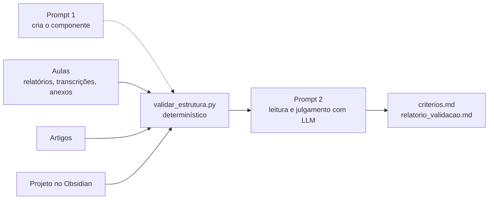

# Validador de estrutura do TCC — plano simples em dois prompts

> **Substitui** o planejamento do mini-harness de triagem bibliográfica, descontinuado em 2026-11-06. A versão anterior continua no [histórico do Git](https://github.com/guisiq/tcc_harnes/blob/d28683f3a8eb7d6df781a258e13d46232b87398a/planejamento_mini_harness_completo.md). O tema e o protocolo vigentes estão no [projeto no Obsidian](TCC_Checkpoint_JSON_Obsidian/00_INDEX.md).

## 1. Objetivo

Conferir, com evidência rastreável, se o projeto em `TCC_Checkpoint_JSON_Obsidian/` cobre o que as aulas de TCC I pedem e se as afirmações centrais batem com os artigos locais. O resultado é uma lista de lacunas e ações, cada uma com a fonte que a justifica.

Não é avaliador de mérito científico, não substitui manual, AVA ou orientador e não edita o projeto: o vault é somente leitura.

## 2. Como funciona



- O **script** faz o que é mecânico e repetível: inventário, extração de texto de anexos e artigos, índice de trechos das aulas, links quebrados e presença das seções.
- O **LLM** faz só o que exige leitura: extrair critérios das aulas e julgar se o projeto os atende, sempre citando aula, anexo ou artigo e a nota do projeto.

| Entrada | Onde | Papel |
|---|---|---|
| Projeto | `TCC_Checkpoint_JSON_Obsidian/` | objeto validado, somente leitura |
| Relatórios de aula | `AULAS/2026-2/relatorios/` | critérios já sintetizados, com links para a transcrição |
| Transcrições | `AULAS/2026-2/transcricoes/*.md` | evidência com âncora `#sNNNN`; consultadas por trecho, nunca inteiras |
| Anexos das aulas | `AULAS/2026-2/anexos/`; o script também varre o resto de `AULAS/` | manual, plano de ensino, modelos e slides; fonte mais forte que a fala |
| Artigos | `artigos/` e [referências](TCC_Checkpoint_JSON_Obsidian/06_Referencias/referencias.md) | conferência das afirmações citadas |

As saídas ficam em `AULAS/2026-2/validacao/`, fora do Git como todo `AULAS/`, porque reproduzem trechos das aulas:

| Arquivo | Gerado por | Conteúdo |
|---|---|---|
| `inventario.json` | script | fontes, hash, categoria e status da extração |
| `fontes/` | script | texto de anexos e artigos (PDF, DOCX, PPTX, XLSX, ODT, HTML) |
| `trechos_aulas.md` | script | trechos de transcrições e anexos por tema, com link |
| `estrutura.md` | script | checagens sintáticas do projeto |
| `criterios.md` | prompt 2 | critérios das aulas e anexos, com força e fonte |
| `relatorio_validacao.md` | prompt 2 | critério × projeto, coerência, artigos e ações |

Requisito: Python 3.10+. PDFs usam `pymupdf` ou `pypdf` quando instalados; sem eles, ficam como pendentes.

## 3. Prompt 1 — modo criação de componente

Rodar uma vez no DeepSeek Harness, com a raiz do repositório como diretório de trabalho. Se o harness aceitar anexos de contexto, anexar as referências listadas no fim do prompt.

```text
MODO: criação de componente.

Crie o componente "validador-tcc" em ferramentas/validador-tcc/. Ambiente: Windows, Python 3.10+ só com a biblioteca padrão; pymupdf ou pypdf são opcionais e só devem ser usados se importáveis. Não instale pacotes, não altere nada fora de ferramentas/validador-tcc/ e nunca edite TCC_Checkpoint_JSON_Obsidian/, artigos/ ou AULAS/ (exceto a pasta de saída do script).

Objetivo: preparar, sem LLM, o material para validar a estrutura do TCC contra as aulas, os anexos das aulas e os artigos. O componente não julga conteúdo.

ARQUIVOS
1. validar_estrutura.py: CLI e lógica.
2. estrutura_esperada.json: elementos esperados e temas de busca (semente abaixo).
3. test_validar_estrutura.py: testes com unittest.
4. README.md curto: o que faz, como rodar, saídas e limites.

CLI
python ferramentas/validador-tcc/validar_estrutura.py [--raiz CAMINHO] [--saida CAMINHO] [--forcar]
- --raiz: raiz do repositório; padrão: duas pastas acima do script.
- --saida: padrão AULAS/2026-2/validacao (criar se não existir).
- --forcar: refazer extrações mesmo com hash igual.
- Código de saída 0 em sucesso, mesmo com pendências; 2 se TCC_Checkpoint_JSON_Obsidian/ não existir.
- Caminhos gravados: relativos à raiz, com "/". Links Markdown: relativos ao arquivo que os contém. Tudo em UTF-8.

ETAPA 1. INVENTÁRIO -> <saida>/inventario.json
Categorias:
- projeto: TCC_Checkpoint_JSON_Obsidian/**/*.md, exceto .obsidian/.
- relatorio_aula: AULAS/**/relatorios/*.md.
- transcricao: AULAS/**/transcricoes/*.md (ignorar .json, .srt e .txt).
- anexo_aula: demais arquivos de AULAS/** com extensão .pdf .docx .pptx .xlsx .odt .html .htm .md .txt .doc .ppt .xls; ignorar a pasta de saída, videos/, README.md, inventario.*, progresso_*.json, .zip e .mp4.
- artigo: artigos/**/*.pdf e artigos/**/*.md, exceto artigos/README.md e as pastas epub/, *.work/ e *.validation/.
Campos por arquivo: categoria, caminho, extensao, bytes, sha256, modificado_em (ISO 8601), texto (caminho do texto legível), status_extracao (ok | pendente | erro), mensagem, palavras, duplicatas.
Deduplicar por sha256 dentro da categoria: manter o primeiro caminho em ordem alfabética e listar os demais em "duplicatas" (há PDFs repetidos em artigos/).

ETAPA 2. EXTRAÇÃO DE TEXTO -> <saida>/fontes/<categoria>/<nome-seguro>.md
Só para anexo_aula e artigo; arquivos .md apontam para si mesmos em "texto". Cabeçalho com origem, sha256 e método. Reaproveitar a extração se o sha256 não mudou, salvo --forcar.
- .pdf: pymupdf, senão pypdf; "## Página N" antes de cada página. Sem biblioteca: pendente ("instale pypdf"). Sem texto extraível: pendente ("PDF escaneado, precisa de OCR").
- .docx: word/document.xml via zipfile + xml.etree; um parágrafo por w:p; estilos de título viram "#".
- .pptx: ppt/slides/slideN.xml em ordem numérica, "## Slide N" + textos a:t; incluir as notas de ppt/notesSlides, se houver.
- .xlsx: uma tabela Markdown por planilha, resolvendo sharedStrings; no máximo 500 linhas por planilha.
- .odt: content.xml, um parágrafo por text:p ou text:h.
- .html/.htm: texto via html.parser. .txt: copiar.
- .doc/.ppt/.xls: pendente ("converta para .docx/.pptx/.xlsx ou PDF").
Erro em um arquivo não interrompe os outros.

ETAPA 3. TRECHOS DAS AULAS -> <saida>/trechos_aulas.md
Cada bloco das transcrições tem: linha <a id="sNNNN"></a>, linha em branco, linha **[hh:mm:ss.mmm - hh:mm:ss.mmm]** texto.
Para cada tema de estrutura_esperada.json["temas_busca"] (regex que ignoram maiúsculas e acentos), listar por transcrição:
- [2026-08-08 P1 00:13:03](../transcricoes/2026-08-08_parte-01.md#s0157) texto do bloco (até 220 caracteres)
No máximo 25 ocorrências por tema e arquivo, avisando quando truncar. Repetir para os textos extraídos de anexo_aula, citando página ou slide.

ETAPA 4. CHECAGENS -> <saida>/estrutura.md (começar com um resumo de contagens)
a) Elementos esperados: para cada item de "elementos", ler as notas_candidatas (caminhos relativos ao projeto). presente = nota existe, tem pelo menos min_palavras e contém algum termo; fraco = abaixo do mínimo ou sem termo; ausente = nenhuma nota. Sem candidata existente, procurar os termos nos títulos de todas as notas e, se achar, marcar fraco com "achado por busca, conferir". Mostrar a fonte de cada elemento.
b) Links do Obsidian: [[alvo]], [[alvo|alias]], [[alvo#Título|alias]] e ![[...]], ignorando blocos de código. Resolver como o Obsidian: caminho relativo à raiz do vault, com ou sem .md, ou nome de arquivo único. Reportar arquivo inexistente e título inexistente, comparando títulos sem diferenciar maiúsculas, acentos e pontuação.
c) Frontmatter: status de cada nota e notas sem frontmatter.
d) Notas de 01_Projeto, 02_Metodologia e 03_Revisao_Literatura sem link para 06_Referencias e sem URL.
e) Artigos locais com nome "Autor ... - Ano - Título": indicar se sobrenome e ano aparecem em 06_Referencias/referencias.md, rotulando como heurística.
f) Cobertura das aulas: datas com transcrição, com relatório e sem relatório; status de AULAS/**/progresso_transcricao.json, se existir.
g) Pendências e erros de extração.
Terminar com: "Limites: checagens sintáticas; não avaliam a qualidade do conteúdo."

ESTRUTURA_ESPERADA.JSON (semente; mudanças futuras só com aprovação humana)
Formato: {"projeto": "TCC_Checkpoint_JSON_Obsidian", "elementos": [{"id", "elemento", "obrigatorio": "sim | condicional | recomendado", "notas_candidatas": [], "termos": [], "min_palavras": 80, "fonte": []}], "temas_busca": {"tema": ["regex"]}}
Abreviações abaixo (no JSON, gravar o caminho completo): T1 = AULAS/2026-2/transcricoes/2026-08-08_parte-01.md; T2 = AULAS/2026-2/transcricoes/2026-08-08_parte-02.md. Síntese no relatório AULAS/2026-2/relatorios/2026-08-08.md.
Elementos (id | elemento | obrigatorio | notas_candidatas | termos | fonte):
E01 | problema de pesquisa | sim | 01_Projeto/01_visao_geral.md, 01_Projeto/03_justificativa_lacuna.md | problema | T1#s0118, T1#s0282
E02 | vínculo com Sistemas de Informação | sim | 01_Projeto/03_justificativa_lacuna.md, 01_Projeto/04_ficha_tema.md | sistemas de informacao | T1#s0054
E03 | objetivo geral e específicos verificáveis (ação, entrega, critério, prazo) | sim | 01_Projeto/04_ficha_tema.md, 01_Projeto/01_visao_geral.md | objetivo | T1#s0670
E04 | perguntas de pesquisa e hipóteses | condicional | 01_Projeto/02_perguntas_hipoteses.md | pergunta, hipotese | T1#s0157
E05 | justificativa e lacuna | sim | 01_Projeto/03_justificativa_lacuna.md | justificativa, lacuna | T1#s0282
E06 | revisão bibliográfica | sim | 03_Revisao_Literatura/00_mapa_literatura.md, 03_Revisao_Literatura/05_metodologia_revisao.md | revisao, literatura | T1#s0118
E07 | trabalhos relacionados e diferenciação | sim | 03_Revisao_Literatura/01_artigos_nucleo.md | relacionad, diferen | T1#s0442
E08 | metodologia | sim | 02_Metodologia/01_metodo_memoria_GU_JSON.md, 02_Metodologia/06_plano_experimental.md | metod | T1#s0118
E09 | experimentos: dados, baselines, recursos e tempo | sim | 02_Metodologia/03_datasets.md, 02_Metodologia/06_plano_experimental.md, 02_Metodologia/07_hardware_tempos.md | experiment, dataset, baseline | T1#s0118, T2#s0191
E10 | cronograma viável | sim | 05_Planejamento/01_cronograma.md | cronograma, prazo | T1#s0212
E11 | ética, reprodutibilidade e ameaças à validade | recomendado | 02_Metodologia/08_ameacas_validade.md | etica, reprodut, ameaca | T1#s0852
E12 | referências | sim | 06_Referencias/referencias.md | referenc | T2#s0297
E13 | registro de orientação: reuniões, decisões e encaminhamentos | recomendado | nenhuma | reuniao, orientador, decisao, encaminhamento | T2#s0408, T2#s0578
temas_busca (regex sem acento):
problema: problema de pesquisa|problema
objetivos: objetivo
hipoteses: hipotese
metodologia: metodolog
experimentos: experiment|dataset|baseline
trabalhos_relacionados: trabalhos? relacionados|estado da arte
referencias_abnt: abnt|referenc|citac
cronograma_prazos: cronograma|prazo|entreg|data limite
banca_avaliacao: banca|criterios? de avaliac|apresentac
formato_documento: template|modelo de (documento|projeto|artigo)|formatac|margem|espacamento
orientacao: orientador|orientac|termo de|reuniao
etica_reprodutibilidade: etica|reprodut|lgpd|consentimento

TESTES (unittest, pastas temporárias, sem depender dos dados reais)
- parse de wikilinks com alias, título e embed, ignorando bloco de código;
- resolução de título com acentos;
- extração de .docx e .pptx montados em memória com zipfile;
- link de trecho gerado a partir de um bloco de transcrição;
- ponta a ponta numa mini-árvore (projeto + AULAS + artigos), gerando inventario.json, estrutura.md, trechos_aulas.md e fontes/.

ACEITE (executar e mostrar a saída)
1. python -m unittest discover -s ferramentas/validador-tcc -v -> todos passam.
2. python ferramentas/validador-tcc/validar_estrutura.py -> gera as saídas em AULAS/2026-2/validacao/.
3. Mostrar o resumo de estrutura.md e quantos anexos e artigos ficaram pendentes.
4. git status não mostra mudanças suas fora de ferramentas/validador-tcc/.

REFERÊNCIAS NECESSÁRIAS
- planejamento_validador_tcc.md
- AULAS/2026-2/README.md
- AULAS/2026-2/relatorios/2026-08-08.md
- AULAS/2026-2/transcricoes/2026-08-08_parte-01.md (só as primeiras 40 linhas, para ver o formato)
- TCC_Checkpoint_JSON_Obsidian/00_INDEX.md
- .gitignore
```

## 4. Prompt 2 — validação do projeto com as referências

Antes de cada rodada, executar `python ferramentas/validador-tcc/validar_estrutura.py`: ele gera os arquivos de `AULAS/2026-2/validacao/` usados como referência. Depois, rodar o prompt com as referências anexadas.

```text
MODO: execução sobre o projeto (não criar nem alterar código).

Valide a estrutura do meu projeto de TCC I contra as aulas, os anexos das aulas e os artigos, usando ferramentas/validador-tcc/. Escreva em português. Grave somente em AULAS/2026-2/validacao/; não edite TCC_Checkpoint_JSON_Obsidian/, artigos/ nem ferramentas/.

PASSO 0. PREPARAR
- Rode: python ferramentas/validador-tcc/validar_estrutura.py
- Se existir AULAS/2026-2/validacao/relatorio_validacao.md, mova-o para AULAS/2026-2/validacao/historico/relatorio_validacao_<AAAA-MM-DD_HHMM>.md.
- Leia estrutura.md e inventario.json. Fonte com status pendente ou erro entra no relatório como "não lida"; nunca presuma seu conteúdo.

PASSO 1. CRITÉRIOS -> AULAS/2026-2/validacao/criterios.md
Ler nesta ordem; a letra indica a força da fonte:
A. anexos (manual, regulamento, plano de ensino, modelos, fichas, slides) em validacao/fontes/anexo_aula/: exigência documentada;
B. relatórios em AULAS/2026-2/relatorios/: orientação de aula;
C. transcrições de aulas sem relatório: localizar por trechos_aulas.md e ler só cerca de 10 blocos antes e depois da âncora, nunca a transcrição inteira: fala de aula, transcrição automática.
Cada critério: ID (C01...), requisito em uma frase verificável, força (A, B ou C), elemento de estrutura_esperada.json relacionado (E01...) ou "novo", seção do TCC, fonte com link e tempo, página ou slide, data da aula.
Regras:
- Exemplo, opinião ou preferência do professor não vira exigência.
- Quantidades citadas (trabalhos, experimentos, páginas) são recomendação, salvo se um anexo as fixar.
- Prazo só é "confirmado" se constar em anexo ou em mais de uma aula; caso contrário, "confirmar no AVA".
- Fontes divergentes: registrar o conflito com as duas citações; prevalece A > B > C e, entre fontes da mesma força, a mais recente.
- Trecho marcado [REVISAR] não sustenta sozinho um critério.
No fim, incluir "Propostas para estrutura_esperada.json" com elementos novos ou fontes melhores, sem editar o arquivo.

PASSO 2. PROJETO × CRITÉRIOS
Para cada critério, procurar no vault (começar por 00_INDEX.md e pelas notas_candidatas do elemento; buscar no restante) e classificar:
✅ atende | 🟡 parcial | ❌ não atende | ❔ não verificável (fonte não lida ou depende de algo fora do repositório, como termo assinado ou AVA).
Evidência: link para a nota e o título, mais uma citação curta de até 25 palavras. Sem evidência, não marcar ✅.
Ação: uma frase concreta dizendo o que escrever ou ajustar e em qual nota.

PASSO 3. COERÊNCIA INTERNA
A aula de 08/08 pede revisar todas as seções quando uma decisão muda. Comparar entre as notas: título e tema, perguntas e hipóteses, objetivos, modelos, datasets, budget de tokens, métricas, hardware e cronograma × prazos das aulas. Listar cada divergência com os dois links.

PASSO 4. AFIRMAÇÕES × ARTIGOS (amostra)
Escolher até 12 afirmações centrais com citação (problema, lacuna, método GU-json, datasets, métricas, modelos). Procurar o trecho em validacao/fontes/artigo/ ou no .md do artigo e classificar: confirmada | parcial | não encontrada | divergente | sem texto local, citando a página. Conhecimento prévio sobre o artigo não conta como evidência.

PASSO 5. RELATÓRIO -> AULAS/2026-2/validacao/relatorio_validacao.md
1. Resumo: data, fontes lidas e não lidas, contagem por status e os três maiores riscos.
2. Próximas ações (até 10), ordenadas pelo prazo das aulas, depois ❌ antes de 🟡, depois pela força da fonte; cada uma com critério e nota alvo.
3. Tabela critério × projeto.
4. Coerência interna.
5. Afirmações × artigos.
6. Conflitos entre fontes e itens a confirmar com AVA ou orientador.
7. Mudanças desde a validação anterior, se houver histórico.
8. Limites desta validação.
Links relativos a AULAS/2026-2/validacao/: projeto em ../../../TCC_Checkpoint_JSON_Obsidian/..., transcrições em ../transcricoes/..., relatórios em ../relatorios/....

Ao terminar, responda apenas com: arquivos gerados, contagem por status, as cinco primeiras ações e as fontes não lidas.

REFERÊNCIAS NECESSÁRIAS
- planejamento_validador_tcc.md
- ferramentas/validador-tcc/README.md
- ferramentas/validador-tcc/estrutura_esperada.json
- AULAS/2026-2/README.md
- AULAS/2026-2/relatorios/ (todos)
- AULAS/2026-2/validacao/estrutura.md
- AULAS/2026-2/validacao/trechos_aulas.md
- AULAS/2026-2/validacao/inventario.json
- AULAS/2026-2/validacao/fontes/anexo_aula/ (todos)
- TCC_Checkpoint_JSON_Obsidian/00_INDEX.md
- TCC_Checkpoint_JSON_Obsidian/06_Referencias/referencias.md
```

## 5. Rotina

1. Salvar anexos novos em `AULAS/2026-2/anexos/`. Preferir PDF, DOCX ou PPTX; `.doc`, `.ppt`, `.xls` e PDFs escaneados ficam pendentes.
2. Gerar o relatório de cada aula transcrita em `AULAS/2026-2/relatorios/`; o prompt 2 usa relatórios antes das transcrições.
3. Rodar o script e o prompt 2. O relatório anterior vai para `validacao/historico/`, e o novo lista o que mudou.
4. Corrigir o projeto manualmente a partir das ações e levar ao orientador o que ficar como "confirmar".

## 6. Limites

- A transcrição é automática e sem revisão humana: prazos, nomes, números e trechos `[REVISAR]` só valem como confirmados se aparecerem em anexo ou em mais de uma aula.
- Hierarquia das fontes: anexo oficial > relatório de aula > fala isolada. Divergências são registradas, não resolvidas.
- Exemplos, preferências do professor e quantidades citadas, como número de trabalhos ou de experimentos, não viram exigência sem documento que as fixe.
- As checagens do script são sintáticas; o julgamento do LLM depende das fontes lidas e deve listar as que não leu.
- Transcrições, anexos e relatórios de validação não devem ser publicados; `AULAS/` permanece no `.gitignore`.
