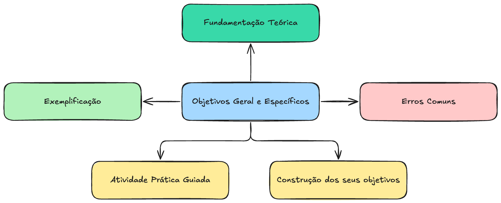
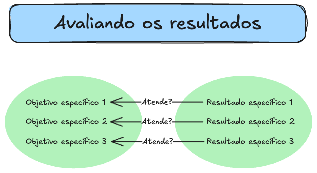

28/02/25
TCC-Objetivos
1
1. Fundamentação
Teórica
🔎 Objetivos Geral e Específicos
2
1

28/02/25
3
1.1. O que são os Objetivos de um TCC
• Objetivo Geral: Declaração ampla do
que se pretende alcançar com a
pesquisa. Representa o propósito
principal do trabalho e deve estar
totalmente alinhado com o título.
• Objetivos Específicos: São
subprodutos do objetivo geral, isto
é, aspectos verificáveis que
contribuem diretamente para sua
realização.
4
2

28/02/25
Objetivos Específicos
Segundo Wazlawick (Metodologia de Pesquisa para Ciência da
Computação), os objetivos específicos não são uma
sequência de passos ou tarefas metodológicas, mas sim
aspectos relevantes que, uma vez atingidos, demonstram que
o objetivo geral foi alcançado. Eles representam componentes
da pesquisa e não meras ações do pesquisador.
5
Exemplo:
• Objetivo Geral: Avaliar o impacto da automação no desempenho
de pequenas empresas do varejo.
• Objetivos Específicos (subprodutos do objetivo geral):
1. Identificar os principais tipos de automação utilizados no varejo.
2. Analisar os efeitos da automação na produtividade das pequenas
empresas.
3. Investigar as dificuldades enfrentadas pelos empresários na
adoção da automação.
6
3

28/02/25
🔹 O que NÃO são objetivos específicos:
• “Realizar uma revisão bibliográfica sobre automação no
varejo.”
• “Coletar dados de 50 empresas para análise.”
• “Testar um modelo de automação em um ambiente
controlado.”
7
💡 Resumo: O objetivo
específico deve indicar o que
será descoberto, analisado ou
demonstrado na pesquisa, e
não quais tarefas serão
executadas para obtê-lo.
8
4

28/02/25
1.2. Processo de Delimitação dos Objetivos
• Passo 1: Delimitar o tema
– Dividir em partes hierárquicas até obter um recorte específico e viável.
– Determinar um limite temporal e espacial (ex.: recorte geográfico ou período
histórico).
– Definir sob qual perspectiva a análise será feita (ex.: técnica, social,
econômica).
• Passo 2: Relacionar o Tema com o Objetivo
– Tema: Onde se pretende atuar.
– Objetivo: O que se pretende fazer sobre esse tema.
9
1.3. Tiposde Pesquisae ObjetivosAssociados
Cada tipode pesquisatemobjetivose verbosespecíficosque ajudama formular corretamenteas intençõesdo estudo:
| Tipo de Pesquisa | Finalidade      | Verbos Apropriados      |
| ---------------- | --------------- | ----------------------- |
| Exploratória     | Compreender um  | Conhecer, Identificar,  |
|                  | fenômeno pouco  | Descobrir, Examinar     |
conhecido.
| Descritiva | Caracterizar e  | Descrever,           |
| ---------- | --------------- | -------------------- |
|            | detalhar um     | Caracterizar, Traçar |
fenômeno.
| Explicativa      | Explicar relações de  | Analisar, Avaliar,    |
| ---------------- | --------------------- | --------------------- |
|                  | causa e efeito.       | Explicar, Verificar   |
| Intervencionista | Testar mudanças e     | Implementar, Testar,  |
|                  | melhorias em um       | Melhorar, Resolver    |
sistema.
| Desenvolvimento | Criar ou aprimorar  | Desenvolver, Criar,  |
| --------------- | ------------------- | -------------------- |
|                 | processos e         | Aperfeiçoar          |
tecnologias.
10
5

28/02/25
Exemplo:
Se o trabalho busca entender a adoção da IA no comércio, o objetivo pode ser:
• Pesquisa exploratória → “Investigar como a IA está sendo adotada no comércio
eletrônico brasileiro.”
• Pesquisa descritiva → “Descrever os impactos da IA nas estratégias de precificação
do comércio eletrônico.”
• Pesquisa explicativa → “Analisar o efeito da IA na fidelização de clientes no
comércio eletrônico.”
• Pesquisa intervencionista → “Testar a implementação de um chatbot de IA para
atendimento ao cliente no e-commerce.”
• Pesquisa de desenvolvimento → “Desenvolver um modelo de IA para otimizar
recomendações de produtos no e-commerce.”
11
2. Exemplificação
e Erros Comuns
🔎 Objetivos Geral e Específicos
12
6

28/02/25
2.1. Características dos
Objetivos Bem Definidos
• São verificáveis ao final do
trabalho.
• Dão resposta à pergunta da
pesquisa.
• Não são meros passos do
método.
13
✔ Exemplos adequados:
• Demonstrar que o método X melhora a eficiência
computacional.
• Avaliar o impacto da técnica Y no desempenho da rede
neural.
14
7

28/02/25
✘ Exemplos inadequados:
• Propor um modelo para otimizar processos (pois “propor”
não significa testar ou validar).
• Estudar algoritmos de classificação (pois “estudar” não
gera uma verificação concreta).
15
2.2. Objetivos que NÃO São Objetivos Específicos
Os seguintes itens devem ser parte da metodologia, mas não dos
objetivos específicos:
• Levantar literatura sobre um tema.
• Escolher um método para análise.
• Implementar um sistema.
• Testar um algoritmo.
• Coletar dados.
• Validar resultados.
16
8

28/02/25
Correção:
Em vez de “Implementar um algoritmo de deep learning”, o
objetivo específico deveria ser “Avaliar o desempenho de um
algoritmo de deep learning na classificação de imagens”.
17
3. Atividade Prática Guiada
Passo 1: Identificação de Problemas nos Objetivos
Considere os objetivos mal formulados e faça a correção dos
problemas com base nas diretrizes apresentadas.
Exemplo de Objetivos Mal Formulados:
1. Propor uma nova abordagem para reconhecimento facial.
2. Implementar um sistema de recomendação de filmes usando
redes neurais.
3. Estudar a relação entre segurança da informação e privacidade
na nuvem.
18
9

28/02/25
A solução passa por reformular esses objetivos tornando-os
verificáveis e alinhados com os tipos de pesquisa.
✔ Possíveis Reformulações:
1. Avaliar a eficácia da abordagem X para reconhecimento facial
em cenários de baixa iluminação.
2. Comparar o desempenho do sistema de recomendação X com
algoritmos tradicionais em bases de dados públicas.
3. Analisar a relação entre segurança da informação e privacidade
na nuvem, considerando técnicas de anonimização de dados.
19
Passo 2: Construção Guiada de Objetivos
1. Escolher um tema de interesse.
1. Granularidade
2. Limite temporal e espacial
3. Sob qual perspectiva
2. Definir um objetivo geral.
3. Formular três objetivos específicos usando verbos adequados.
4. Revisar e justificar se os objetivos são verificáveis e bem delimitados.
20
10

28/02/25
Exemplo de Aplicação:
• Tema: Redes neurais para previsão de séries temporais.
• Objetivo Geral: Avaliar o desempenho de redes neurais na previsão de séries temporais
financeiras.
• Objetivos Específicos:
1. Comparar a precisão de modelos LSTM e ARIMA na previsão de séries temporais
financeiras.
2. Analisar o impacto da regularização na estabilidade dos modelos LSTM.
3. Investigar a influência do tamanho da janela deslizante na qualidade das previsões.
21
Qual é a importância dos objetivos específicos?
22
11

28/02/25
4. Encerramento e Reflexão
• Os principais pontos discutidos.
• Os objetivos bem formulados levam o sucesso do TCC.
• Dúvidas e desafios enfrentados pelos alunos.
23
Referências
• Wazlawick, Metodologia de
Pesquisa para Ciência da
Computação
• GERHARDT, T. E.; SILVEIRA, D.
T. (Org.). Métodos de
pesquisa. 1ª edição. Porto
Alegre: UFRGS, 2009.
24
12

## Extracted Images

### Page 1

### Page 2

### Page 4

### Page 6

### Page 7

### Page 10

### Page 11

