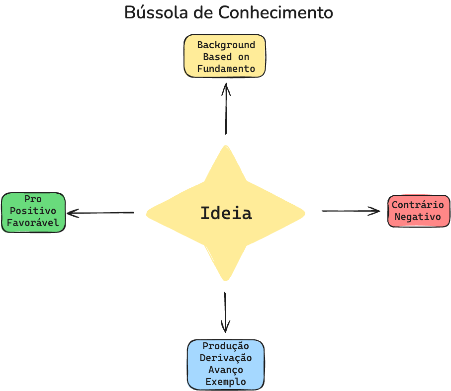

METODOLOGIA DA BÚSSOLA DE CONHECIMENTO
A Bússola de Conhecimento é um recurso para validação e desenvolvimento crítico de ideias no contexto de
pesquisa acadêmica. O método organiza as anotações em quatro eixos ao redor da ideia central, permitindo
identificar fundamentos, evidências favoráveis, críticas e possibilidades de expansão.
Eixo Norte — Fundamentos e Background - Reúne as bases teóricas, dados prévios e referências que
sustentam a ideia. É o ponto de partida para buscar conceito apoiado em conhecimento validado e em
fundamentos sólidos.
Eixo Oeste — Aspectos Positivos e Favoráveis - Inclui evidências, resultados de estudos, opiniões e
argumentos que reforçam ou aprimoram a ideia. Este quadrante ajuda a visualizar seu potencial e a
identificar seus pontos fortes.
Eixo Leste — Aspectos Contrários e Limitações - Registra críticas, limitações, contradições e evidências
negativas. Essa perspectiva é essencial para reduzir vieses de confirmação e garantir que a análise seja
equilibrada.
Eixo Sul — Derivações e Desenvolvimentos Possíveis - Contém propostas de evolução, aplicações
práticas, novas hipóteses e caminhos para aprofundamento. Aqui o foco é expandir o alcance da ideia e
gerar oportunidades de pesquisa.
Metadados e Conexões Qualificadas - Os termos que conectam cada elemento da bússola à ideia central
são tratados como metadados, permitindo criar conexões qualificadas no Obsidian. Dessa forma, os links
entre notas são estruturais e semânticos, reforçando a rastreabilidade e a contextualização de cada
argumento, evidência ou contraponto.
A aplicação desta metodologia no TCC evidencia o pensamento crítico e uma análise equilibrada, além de
fornecer um panorama estruturado para cada abordagem de sua proposta. Ao integrar evidências positivas
e negativas com fundamentos e projeções, e ao utilizar metadados para conexões qualificadas, a Bússola
de Conhecimento apoia decisões mais robustas e embasadas no processo de construção acadêmica.

Metadados para Conexões Qualificadas (Obsidian / Excalibrain)
| Localização  | Metadado  | Justificativa de uso acadêmico  |
| ------------ | --------- | ------------------------------- |
Norte — Fundamentos e Background
| Norte  | author  | Identifica o autor de referência da ideia.  |
| ------ | ------- | ------------------------------------------- |
Norte  background  Contexto histórico ou situacional que originou a ideia.
Norte  based on  Indica teorias, obras ou experimentos que fundamentam
a ideia.
Norte  builds upon  Obras, teorias ou experimentos que fundamentam a
ideia.
Norte  category  Classificação temática/área do conhecimento.
Norte  cited in  Relaciona trabalhos nos quais a ideia já foi citada, útil
para análise de impacto acadêmico.
| Norte  | credits       | Reconhecimento de contribuições diretas.  |
| ------ | ------------- | ----------------------------------------- |
| Norte  | developed by  | Quem desenvolveu o conceito/técnica.      |
Norte  example of  Indica que a ideia é caso particular de um conceito maior.
| Norte  | extends  | Ampliação de trabalho ou conceito prévio.  |
| ------ | -------- | ------------------------------------------ |
| Norte  | from     | Origem da informação ou do conceito.       |
Norte  implements  Aplicação de modelo ou método pré-existente.
| Norte  | inception    | Momento de concepção/primeiro registro.  |
| ------ | ------------ | ---------------------------------------- |
| Norte  | inspiration  | Ideias que inspiraram o trabalho.        |
Norte  instance of  Tipologia formal que a ideia representa.
| Norte  | member of     | Vínculo com escola, grupo ou teoria.  |
| ------ | ------------- | ------------------------------------- |
| Norte  | mentioned by  | Autores que citam a ideia.            |
Norte  origin  Origem geográfica, institucional ou disciplinar.
Norte  parent domain  Área de conhecimento mais ampla a que pertence.
| Norte  | part of      | Parte de um sistema/conjunto maior.  |
| ------ | ------------ | ------------------------------------ |
| Norte  | question     | Pergunta de pesquisa relacionada.    |
| Norte  | refines      | Aprimoramento de ideia existente.    |
| Norte  | source       | Referência bibliográfica principal.  |
| Norte  | subtopic of  | Derivação de tópico maior.           |
Norte  summarized by  Fonte que apresenta resumo/consolidação.
| Norte  | theme  | Tema central ou linha de pesquisa.  |
| ------ | ------ | ----------------------------------- |
Norte  theoretical framework  Liga a ideia a um arcabouço teórico formal.

| Localização  | Metadado  | Justificativa de uso acadêmico  |
| ------------ | --------- | ------------------------------- |
Sul — Derivações e Desenvolvimentos
| Sul  | answer          | Respostas geradas a partir da hipótese/ideia.  |
| ---- | --------------- | ---------------------------------------------- |
| Sul  | assumptions     | Premissas usadas para avançar a pesquisa.      |
| Sul  | Child           | Desdobramentos/aplicações diretas.             |
| Sul  | compares        | Comparações estruturadas com outras ideias.    |
| Sul  | components      | Partes que compõem a ideia.                    |
| Sul  | conclusion      | Conclusões derivadas do desenvolvimento.       |
| Sul  | consists of     | Composição/estrutura da proposta.              |
| Sul  | contributes to  | Contribuições para objetivos maiores.          |
| Sul  | example         | Exemplo aplicado para validação.               |
| Sul  | examples        | Conjunto de exemplos ilustrativos.             |
| Sul  | how to          | Método/procedimento de aplicação.              |
| Sul  | illustrates     | Materiais que demonstram a ideia.              |
| Sul  | impacts         | Impactos previstos/observados.                 |
| Sul  | implemented by  | Meios/tecnologias de implementação.            |
| Sul  | instances       | Casos/instâncias concretas.                    |
Sul  is documented in  Registros/documentos do desenvolvimento.
| Sul  | leads to  | Consequências/resultados esperados.      |
| ---- | --------- | ---------------------------------------- |
| Sul  | needs     | Necessidades/requisitos para aplicação.  |
Sul  next iteration of the idea  Melhorias futuras planejadas.
| Sul  | next level detail  | Detalhamento aprofundado.                    |
| ---- | ------------------ | -------------------------------------------- |
| Sul  | nurtures           | Elementos que fortalecem o desenvolvimento.  |
| Sul  | questions          | Novas questões derivadas.                    |
| Sul  | requires           | Requisitos técnicos/teóricos.                |
| Sul  | such as            | Exemplos complementares.                     |

| Localização  | Metadado  | Justificativa de uso acadêmico  |
| ------------ | --------- | ------------------------------- |
Oeste — Aspectos Positivos e Favoráveis
| Oeste  | advantages     | Benefícios observados.               |
| ------ | -------------- | ------------------------------------ |
| Oeste  | also known as  | Outros nomes ou sinônimos.           |
| Oeste  | alternative    | Abordagens alternativas favoráveis.  |
| Oeste  | applicable to  | Contextos/áreas de aplicação.        |
Oeste  applied in case study  Registra aplicação prática validada por estudo de caso.
Oeste  confirmed by  Liga a ideia a outros trabalhos que chegaram ao
mesmo resultado.
| Oeste  | pros              | Pontos positivos.                         |
| ------ | ----------------- | ----------------------------------------- |
| Oeste  | referenced by     | Trabalhos que citam favoravelmente.       |
| Oeste  | references        | Referências bibliográficas relacionadas.  |
| Oeste  | related research  | Pesquisas conexas de suporte.             |
| Oeste  | related to        | Tópicos próximos/complementares.          |
| Oeste  | relevant to       | Relevância em contexto específico.        |
| Oeste  | reminds me of     | Ligações com conceitos próximos.          |
| Oeste  | see also          | Remissões para conteúdos relacionados.    |
| Oeste  | similar to        | Similaridade com outras abordagens.       |
| Oeste  | supported by      | Evidências/autores que sustentam.         |
Oeste  supported by dataset  Vincula à base de dados ou fonte empírica que
sustenta a conclusão.
| Oeste  | supports  | Como a ideia reforça outras iniciativas.  |
| ------ | --------- | ----------------------------------------- |
Oeste  touches on a similar topic  Relação tangencial com temas afins.
Oeste  validated by  Conecta a ideia a estudos, experimentos ou resultados
que a validaram.

| Localização  | Metadado  | Justificativa de uso acadêmico  |
| ------------ | --------- | ------------------------------- |
Leste — Aspectos Contrários e Limitações
| Leste  | attacks  | Críticas diretas.  |
| ------ | -------- | ------------------ |
Leste  challenged by  Liga a trabalhos que levantam questionamentos ou
fragilidades.
| Leste  | challenges     | Desafios a serem superados.         |
| ------ | -------------- | ----------------------------------- |
| Leste  | cons           | Pontos negativos identificados.     |
| Leste  | contradicts    | Contradições com outros trabalhos.  |
| Leste  | denies         | Negações diretas de premissas.      |
| Leste  | disadvantages  | Desvantagens percebidas.            |
| Leste  | disproves      | Evidências que refutam.             |
| Leste  | falsifies      | Dados que invalidam a hipótese.     |
| Leste  | goes against   | Oposição a premissas/resultados.    |
Leste  limited by  Relaciona limitações explícitas da aplicação ou da
metodologia.
| Leste  | missing  | Lacunas identificadas.  |
| ------ | -------- | ----------------------- |
| Leste  | opposes  | Oposição explícita.     |
Leste  refuted by  Indica trabalhos que apresentaram evidências
contrárias diretas.
| Leste  | undermines  | Elementos que enfraquecem a proposta.  |
| ------ | ----------- | -------------------------------------- |
| Leste  | weakens     | Fatores que reduzem a força da ideia.  |

Professor Marco Antonio Firmino de Sousa

## Extracted Images

### Page 1

### Page 2

### Page 3

### Page 4

### Page 5

